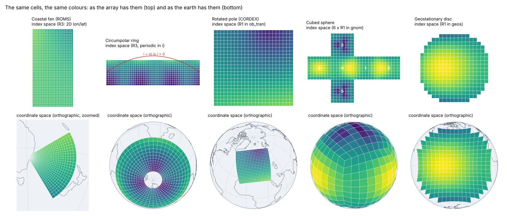
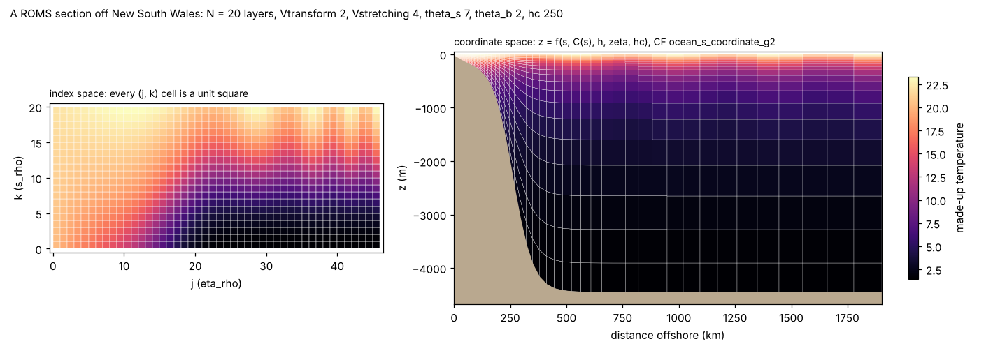

# m06: Index space and coordinate space, from the playproj pages to Zarr

Status: musing, 2026-10-17. It surveys the
[playproj](https://github.com/hypertidy/playproj) pages for what they say
about mapping data onto different surface representations, places each on
doc 02's ladder, checks what wxylib reads and warps today, and ends with a
small set of Zarr fixtures and four questions. It becomes work only through
a numbered document; core and fixtures belong to the planning thread.

## 1. The ask

Michael, 2026-10-17:

> We could start looking at the playproj examples for use with Zarr
> https://hypertidy.github.io/playproj/indexspace.htm and the other
> examples generally for mapping data onto different surface
> representations

Gate 1 already organises core around the R0 to R6 ladder, with
regular-in-what and playproj as its references. What playproj adds is a
set of worked, tested constructions: each page builds a grid from first
principles, checks it against PROJ, GDAL, s2sphere, zarr-python or ROMS's
own Fortran, and shows the array and the earth as two views of one thing.
That is exactly a fixture's job, so the pages are a ready supply of cases.

## 2. Index space and coordinate space

Every array has an index space: integer positions `(i, j, k, ...)` where
every cell is a unit cube and neighbours are `+1` and `-1`. A mapping takes
an index to a coordinate space: longitude and latitude, a projected CRS,
depth. Doc 02's ladder is a ladder of how much that mapping costs to
store, from nothing (R0) to six numbers (R1) to a position per cell (R3).

*The same cells and colours in both rows. The colour is a field of the
place, so it moves with the cells; the cells stay square in the top row
and bend in the bottom one. Made by `scripts/m06_figures.py` from numpy
ports of playproj's constructions (spherical earth, pictures only).*

Two things the figure makes plain:

- **R3 can be R1 in disguise.** The rotated-pole and geostationary panels
  are curvilinear on the globe but perfectly regular in their own frames
  (`ob_tran`, `geos`). The fan and the ring are regular in no common frame
  (the fan is regular in log-polar stereographic radius, the ring in
  Mercator y but periodic). regular-in-what's field guide and playproj's
  `regular.html` are about telling these apart.
- **Index space has its own topology.** The ring's last column is
  adjacent to its first. The cubed sphere is six index spaces whose edges
  meet with turns. A tripolar grid's top row meets itself reversed. None
  of that is in the coordinates; it is in how the index is joined.

The vertical makes the same point a third time, from `indexspace.html`:

*Terrain-following layers: N layers in every column, so `(j, k)` is a
regular grid while depth is a function of the layer, the stretching curve,
the water depth `h`, the free surface `zeta` and `hc`. CF calls this
`ocean_s_coordinate_g2`; ROMS calls it Vtransform 2.*

## 3. The pages, placed

| playproj page | Surface | Rung | In Zarr it would be | wxylib today |
|---|---|---|---|---|
| `indexspace.html` (ROMS) | curvilinear horizontal, s-coordinate vertical | R3 horizontal; vertical computed from index and fields | `lon_rho`, `lat_rho`, `h`, `mask_rho`, `s_rho`, `Cs_r`, `hc`; `temp(ocean_time, s_rho, eta_rho, xi_rho)` | Horizontal yes (S5b: 2D lon/lat by `coordinates`, centres, geoloc warp equals GDAL). `s_rho` reads as a 1D coordinate in an unspecified frame; no depth. Stagger points (u, v, psi) open as separate arrays; `RelationKind::Stagger` exists in wxy-domain but no reader sets it. |
| `grids.html` rotated pole | CF `rotated_latitude_longitude` | R1 in `ob_tran`, stored as R2 (rlon, rlat) plus R3 (2D lon/lat) | `rlon`, `rlat`, a grid-mapping variable, 2D `lon`, `lat` | Reads the 2D lon/lat as R3 (primary) and rlon/rlat as R2 in `cf:unspecified`. CF `grid_mapping` is not read, so the R1 form is lost. `regular_grid_through` can recover it, given the frame function. |
| `grids.html` tripolar | Mercator lon/lat joined to a bipolar cap | R3 with a fold | 2D lon/lat as MOM6 or NEMO write them | 2D lon/lat yes; the fold (top row meets itself reversed) is not represented. |
| `grids.html` cubed sphere | six gnomonic faces | 6 x R1 (each face R1 in its `gnom`) | `(tile, y, x)` with `lon(tile, y, x)`, as FV3 and UFS write | No: curvilinear mapping is read only from 2D coordinate arrays over the last two dims; a patch dim that selects the mapping has no home. |
| `grids.html` Yin-Yang | two overlapping lon/lat patches | 2 x R1 | two arrays, or a patch dim | As above: patches. |
| `regular.html` geostationary | equal steps of scan angle | R1 in `geos` | `x`, `y` in radians, a `geostationary` grid mapping, sometimes 2D lon/lat with NaN off the disc | `x`, `y` read as R2 in `cf:unspecified`; no grid mapping. NaN in 2D geolocation arrays not checked. |
| `regular.html` NSIDC, EASE, HRRR, MODIS, OISST | 2D lon/lat shipped for a grid regular in some CRS | R3 stored, R1 true | 2D lon/lat with or without projected axes | Tests in wxy-domain (`tests/regular_in_what.rs`) recover several with a caller-supplied frame. No candidate search like `regular.js` (fit an affine per candidate CRS, Nelder-Mead on the bending parameters). |
| `structure.html` | tiles, chunks, overviews of COG, Zarr, WMTS | R1 plus chunk and level structure | Zarr chunks, shards, `multiscales` | Chunk grids yes (wxy-source); overviews as `RelationKind::Overview`; GeoZarr `multiscales` not yet read. |
| `rasterize.html` | polygon onto grid, centre-in and exact | R6 to R1 | n/a (an operation) | Done (S4c: GDAL burn identical, exact coverage via controlledburn). |
| `cells.html` (S2), `bins.html` (L3 bins) | cells numbered by a scheme | R4 | a 1D array over cell id, with the scheme named in attributes | `CellScheme` trait exists; no implementation. |
| `sentinel.html` (MGRS, UTM, UPS) | many R1 tiles, each in its own zone | patches of R1 | one array per tile, or a tile dim | Each tile alone is R1 (works); the set is patches. |
| `index.html`, `cones.html`, `globals.html`, `spilhaus.html`, `tissot.html` | projections themselves | frames, not grids | the target of a warp | A warp target needs a CRS proj4rs can run; several are not (see the [CRS input guide](https://github.com/wxylib/docs/blob/main/crs-input.md)). |
| `catastrophes.html`, `example.html` | seams, poles, winding | R6 on the sphere | n/a | Relevant to R6 and to target grids crossing seams; not a Zarr question. |

## 4. What that shows is missing

Five gaps, all in the R1 to R3 family, none needing a new rung:

1. **Positions computed from other fields.** Depth in a terrain-following
   grid is a function of the index *and* of stored fields (`h`, `zeta`) and
   scalars (`hc`, `Cs_r`). CF spells these as `formula_terms`
   (`ocean_s_coordinate_g1`, `g2`, `ocean_sigma_coordinate`,
   `atmosphere_hybrid_sigma_pressure_coordinate`). Doc 02's R3' (fitted
   models) is the nearest variant: a function of the index. The new part is
   that its coefficients are fields, and that `zeta` varies in time, so the
   mapping for one dim depends on a dim it does not cover.
2. **Index topology.** A dim can be periodic (the ring, every global
   lon/lat model grid), or two dims can fold (tripolar). That changes
   neighbours, the cell across the seam (between the last and first
   centres of a ring lies a real cell that a non-periodic reader drops),
   interpolation and the inverse search.
   Today a `Dim` has a name and a size.
3. **Patches.** A dim whose index picks a different mapping: cubed-sphere
   tiles, Yin and Yang, MGRS zones, S2 faces. Either a collection of
   domains with a patch relation, or a mapping keyed by a dim.
4. **Reading the stored frame.** CF `grid_mapping` names the frame in
   which the 1D axes are regular (rotated pole, geostationary, polar
   stereographic). Reading it gives R1 for free and is cheaper and safer
   than recovering it from 2D lon/lat. Today only GeoZarr `proj:` sets a
   frame.
5. **Holes in geolocation.** A geostationary disc's 2D lon/lat are NaN off
   the earth. Whether `geoloc.rs` (a port of GDAL's) and GDAL agree on
   that is unchecked.

## 5. Proposed fixtures

Small Zarr v3 stores, each with a script, a manifest and an oracle, in the
style of `wxylib/fixtures`. Index space against coordinate space is the
theme: every case stores what a real producer stores, plus the truth that
producer threw away, so a reader can be checked on both.

| Case | Built like | Stored | Oracle | Checks |
|---|---|---|---|---|
| **I1 roms-fan** | playproj `fan()` and `test/make-roms-fixture.py` | ROMS names and CF attributes: `lon_rho`, `lat_rho`, `h`, `mask_rho`, `s_rho` with `formula_terms`, `Cs_r`, `hc`, `Vtransform`; `temp(s_rho, eta_rho, xi_rho)`, about 24 x 47 x 8 | depths from the NumPy port of ROMS `set_depth` already in playproj; GDAL geolocation warp of the top layer (osgeo.gdal) | reader keeps the leading `s_rho` dim; the vertical gap (4.1) has a target; playproj's `indexspace.html` can open the same store (`zu=`), a cross-implementation check |
| **I2 ring** | playproj `southernOcean()` | 2D lon/lat centres, periodic in i, no halo column | GDAL geolocation warp to EPSG:3031 | the seam (4.2): expected finding is a missing column of cells in both GDAL and wxylib; documents it before it is fixed |
| **I3 rotated** | playproj `rotatedPole()`, EURO-CORDEX window, coarse | `rlon`, `rlat`, CF `rotated_latitude_longitude` grid mapping, and 2D `lon`, `lat` | the affine in `ob_tran` that built it (PROJ via osgeo.osr checks the 2D arrays) | `regular_grid_through` recovers the affine at float32 tolerance; a later reader of CF `grid_mapping` (4.4) gives it without fitting |
| **I4 geos** | playproj `regular.js` GOES-East example, small | `x`, `y` scan angles in radians, CF `geostationary` grid mapping, 2D lon/lat with NaN off disc | GDAL warp from the affine in `+proj=geos` and from the 2D arrays | the NaN case (4.5); R1 against R3 for the same data |
| **I5 cubed** | playproj `cubedSphere()`, equiangular, n = 8 | `(tile, y, x)` field, `lon(tile, y, x)`, `lat(tile, y, x)` as FV3 writes | per-tile GDAL warp to EPSG:4326, mosaicked | patches (4.3); the reader's last-two-dims rule |

A tripolar case and the R4 schemes (L3 bins, S2) are left for later: the
fold is the hardest piece of index topology and R4 has its own reader
question.

### Smallest pilot

I1 alone, or I1 and I3. I1 is the page Michael pointed at, exercises a
3D curvilinear array that real ROMS output looks like, and has its oracle
half-written in playproj. I3 is cheap and turns an existing wxy-domain
function into a fixture-backed check.

### What do we get, what does it cost, what if we didn't

- **Get:** fixtures that pin the R1 to R3 family's open edges (vertical,
  periodic, patches, stored frames) before any of them is designed, so the
  design in doc 02 answers real stores rather than imagined ones. A shared
  store that playproj's browser reader and wxylib both open is a second
  implementation for free.
- **Cost:** five small scripts and stores (well under a megabyte each),
  each needing GDAL 3.12+ through osgeo.gdal for the oracle, as the
  existing fixtures do. Some oracles will record GDAL's own limits (the
  ring's seam), which then need saying so in the manifest.
- **If we didn't:** the R3 path stays tested only on swaths and OISST-like
  stores, which are the easy cases; the first ROMS, FV3 or GOES user finds
  the gaps instead.

## 6. Questions

1. **Pilot.** Hand I1 (and I3) to the planning thread as fixtures in
   `wxylib/fixtures` under `index/`? Recommended: yes, I1 and I3; the
   rest wait for the gaps they exercise to be designed.
2. **Vertical positions.** Treat CF `formula_terms` coordinates as R3'
   (a function of the index) whose coefficients may be fields, or as a
   separate kind of mapping? Recommended: R3' with field terms, so the
   ladder does not grow.
3. **Store dialect.** Write I1 with ROMS's own names plus CF attributes
   (what ROMS output and playproj's reader use), or translate to GeoZarr?
   Recommended: ROMS names plus CF; GeoZarr has no vertical or
   curvilinear convention yet.
4. **playproj link.** Point `indexspace.html` at the I1 store as an
   example (a change in hypertidy, so Michael's call)? Recommended: yes,
   once the store is published somewhere a browser can fetch it.

## 7. Provisional default

Under standing autonomy the recommended answers above stand until Michael
says otherwise; nothing is built from this musing until a numbered
document or the planning thread picks it up.
