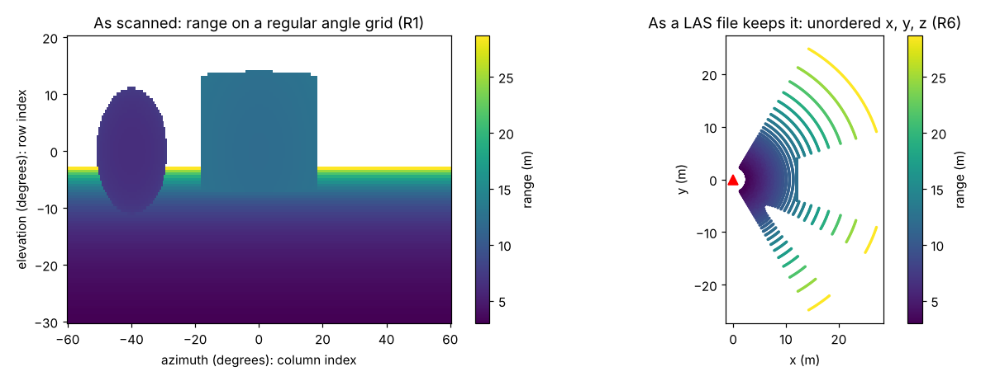
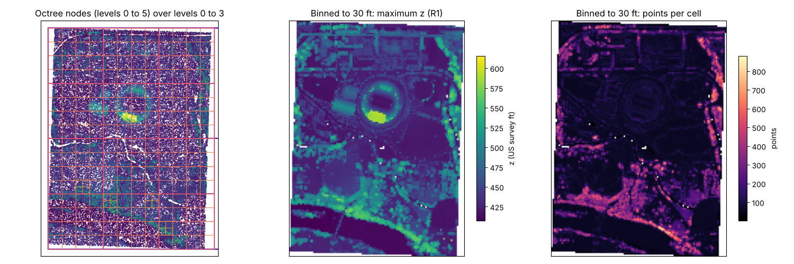

# m08: Point clouds, lidar and PDAL on the ladder

Status: musing, 2026-10-18; its six decisions are in section 8, and doc
02 section 3 carries the ladder note. It places point clouds (lidar, photogrammetry,
terrestrial scans) on doc 02's ladder, surveys the Rust crates and the
PDAL side, and proposes a stance: wxylib reads and writes points as one
more domain on the ladder and moves them between rungs, but does not
become a point cloud processing toolkit. Nothing is built from it; it
becomes work only through a numbered document.

**Implementation (2026-10-28):** Decided, not built. The stance in section 8 holds; no point
cloud stage has been opened.

## 1. Summary

How do PDAL, lidar and points generally fit on the type ladder, and what
stance should wxylib take on point tooling? Point clouds are R6 on an R1
lattice, with an optional R4 chunk scheme for COPC and EPT; raw scans
before LAS are R1, R3 or R3' in the sensor frame, so no new rung is
needed. wxylib reads and writes points as Arrow columns (GeoArrow points,
GeoParquet out), treats COPC as already virtual, and moves points between
rungs (grid to points, points to grid) under plans with `--dry-run`. It
builds no processing toolkit: PDAL stays the oracle and the workaround.

Doc 02 mentions points once ("a point layer is an R5 mesh with no
connectivity") and m01 lists point clouds through PDAL as something a
downstream front end would want. `wxy points` exists, but it reads raster
values *at* points; it does not read point data. So the question is new.

## 2. Where point clouds sit

A LAS or LAZ file is R6 in doc 02's terms: a geometry (a 3D point) per
element, no shared topology, and the element index (point id) carries no
position. Attributes (intensity, return number, classification, GPS
time, colour) are fields on that domain, exactly as bands are fields on a
grid. So far this is the "point layer" row. Three things make point
clouds more interesting than that row suggests.

**The positions are quantised.** LAS stores x, y and z as int32 with a
per-file scale and offset (autzen below: 0.01 in each axis). Every point
therefore sits on a regular 3D lattice, and a point cloud is a *sparse*
R1 array: an affine (the scale and offset) plus a coordinate list of the
occupied lattice cells. Binning to a grid whose cell is a multiple of the
scale is integer arithmetic on the stored values, and LAZ compresses
well because neighbouring points have small integer deltas. This is the
same observation as doc 02's "every rung can describe everything above
it": R6 point storage is R1 storage with most of the cells missing.

**The chunk scheme is spatial, and implicit.** A COPC file (an LAZ 1.4
file arranged as a clustered octree) groups points into nodes keyed by
(level, x, y, z). A node's cube follows from its key by arithmetic, the
way a DGGS cell or a tile matrix cell does: R4 is the chunk scheme, R6 is
the element storage. That is the one real difference from a raster store.
A Zarr chunk key comes from the index; a COPC node key comes from the
position. So "which chunks does this query touch" goes through positions
for points and through the index for grids, but it is the same planning
question, and S4c's planner already answers it from positions for
rasters (`plan_points` maps positions to cells, then cells to chunks).

**The sensor saw a grid.** Before a scan becomes a LAS file it has an
index. A terrestrial scanner sweeps a regular azimuth and elevation grid
and records a range per cell: R1 in the sensor's angle frame, the
"regular in another frame" case of regular-in-what's field guide. An
airborne or mobile scanner records scan lines by pulses within a line:
R3, like a VIIRS swath, and multiple returns per pulse are a ragged
dimension under it. Full waveform lidar samples each pulse at regular
time steps along a ray, which is a fitted function of the index (R3').
E57's structured scans keep the row and column; LAS throws them away.

*The same returns twice. Left, as the scanner records them: range on a
regular (azimuth, elevation) grid, a raster in the sensor's frame.
Right, as a LAS file keeps them: x, y and range per point with no order.
The arcs on the right are the rows of the left; the structure is still
in the positions, but the file no longer knows it. A ground plane, a
wall and a sphere, ray cast in `scripts/m08_figures.py`.*

| Form | Rung | Positions come from | Example |
|------|------|---------------------|---------|
| Structured terrestrial scan | R1 in the sensor frame | azimuth and elevation steps, range as a field | E57 with row and column |
| Airborne or mobile scan lines | R3 (plus a ragged returns dim) | a position per pulse, indexed by line and pulse | raw sensor-order returns |
| Waveform samples | R3' | origin plus direction times time, per pulse | LAS waveform packets, PulseWaves |
| LAS, LAZ, PLY | R6 on an R1 lattice | stored scaled integers per point | almost every delivered lidar tile |
| COPC, EPT | R6 elements, R4 chunk scheme | stored points; nodes by octree key | cloud-hosted lidar, USGS 3DEP via EPT |
| Gridded products (DEM, DSM, CHM, density) | R1 | an affine | Geoscience Australia 5 m lidar DEM COGs |
| TIN from ground points | R5 | points plus triangles | DEM interpolation, PDAL `filters.delaunay` |

So the ladder needs no new rung. What point clouds add is a chunk scheme
keyed by position, and very large element counts.

## 3. The moves

The point operations people run most are moves along the ladder, and
they meet machinery wxylib already has:

- **Grid to points (R1 to R6).** Sampling a raster at every point:
  colourising from imagery (PDAL `filters.colorization`), height above
  ground from a DEM (`filters.hag_dem`). This is S4c's extraction run over
  millions of points, chunk planned, each raster chunk fetched once. The
  new part is only that the points arrive by octree node rather than as a
  CSV.
- **Points to grid (R6 to R1).** Binning: count, minimum, maximum, mean,
  percentiles per cell, as PDAL's `writers.gdal` in its bin mode (points
  inside the cell; the default mode instead takes every point within a
  radius of resolution times the square root of two of the centre, and
  can fill gaps by inverse distance). This is the inverse of zonal
  statistics: zones are cells, values are points. It produces DEMs,
  DSMs, density and canopy height grids.
- **Points to mesh to grid (R6 to R5 to R1).** Triangulate ground points
  and rasterize the triangles: the usual bare-earth DEM. It needs the
  topology module (S8) first.
- **Points to points across frames.** Reprojection, which for lidar is
  nearly always a compound CRS. The autzen file below is NAD83 Oregon GIC
  Lambert in international feet plus NAVD88 height in US survey feet;
  the Geoscience Australia DEM keeps AUSGeoid and quasigeoid zones apart for the same
  reason. Vertical datums need geoid grids, which only PROJ has (the
  open PROJ-in-Rust question, doc 01 M2, gets sharper here).

What is not a ladder move, and is where PDAL, lidR and lasR earn their
keep: ground classification, outlier and noise filters, segmentation,
tree detection, registration, thinning by geometry, building extraction.

*PDAL's autzen-classified COPC file, read over HTTP. Left: the octree
node footprints (levels 0 to 5) over the points of levels 0 to 3. Middle
and right: the same 2.08 million points binned to a 30 ft grid, maximum z
and count. Drawn by `scripts/m08_figures.py` (laspy with the lazrs
backend, which is laz-rs).*

## 4. COPC is already virtual

The autzen file (10,653,336 points, point format 7, 81 MB) needs two
range requests to plan any query: the header and COPC info (589 bytes),
then the root hierarchy page (8,896 bytes, 278 entries of 32 bytes). Each
entry is (level, x, y, z, offset, byte size, point count), which is a
byte-reference table: a chunk key, a byte range and a codec (LAZ, with
the LAS header as its configuration). By level:

| Level | Nodes | Points | Bytes | Node edge (ft) |
|-------|-------|--------|-------|----------------|
| 0 | 1 | 61,201 | 763,258 | 4,655.5 |
| 1 | 4 | 69,859 | 886,840 | 2,327.8 |
| 2 | 12 | 446,577 | 4,668,669 | 1,163.9 |
| 3 | 48 | 1,504,879 | 14,196,473 | 581.9 |
| 4 | 192 | 8,380,771 | 59,024,739 | 291.0 |
| 5 | 21 | 190,049 | 1,571,063 | 145.5 |

Levels 0 to 3 (2.08 million points, a fifth of the file) cost 20 MB of
the 81. That is a level of detail ladder in the same sense as raster
overviews, and an `Explain` for a COPC query would print this table cut
to the query box.

So COPC is to points what a tiled COG is to rasters in doc 05's view
(D2): already virtualised, and scanning it into Icechunk would
copy a table the file already holds. The "Bytes in place" test applies
unchanged: no new byte-ref schema. If a refs row is ever useful (a
catalogue across many COPC files, or the chunk cache seeing point
reads), the hierarchy maps straight onto the mdim-refs columns with a
`laz` codec; that is an export, not a format.

Plain LAZ also has a chunk table (byte offsets of fixed runs of points)
but no spatial key, so a box query reads every chunk. The answer there is
converting to COPC with tools that exist (PDAL `writers.copc`, untwine,
copc-rs's writer), not a wxylib scanner.

## 5. The landscape

| Piece | State (crates.io, 2026-10-18) | Fit |
|-------|-------------------------------|-----|
| [las](https://github.com/gadomski/las-rs) (Pete Gadomski) | 0.11.1, 2026-08-25 | **adopt.** LAS 1.0 to 1.4, LAZ through laz, CRS VLRs, a `CopcReader` with box and level queries (0.11.0), and `PointData`, a byte slab with column accessors for bulk reads. Its maintainer also maintains stac-rs |
| [laz](https://github.com/tmontaigu/laz-rs) (Thomas Montaigu) | 0.13.0, 2026-08-20 | **adopt, through las.** The LAZ codec, with a rayon feature for parallel chunks; also the engine under Python's lazrs, which laspy uses |
| [copc-streaming](https://github.com/360-geo/copc) (360-geo) | 0.2.0, 2026-07-17 | **watch, likely adopt.** Async COPC reads over a `ByteSource` trait, hierarchy pages loaded on demand, no `Send` bound so it builds for wasm, and a temporal index extension. Pins las 0.10 and laz 0.12, a version behind |
| [copc-rs](https://github.com/pka/copc-rs) (Pirmin Kalberer) | 0.5.0 | **use only for writing.** Its reader overlaps las's; its `writer` feature writes COPC |
| [e57](https://github.com/cry-inc/e57) | 0.11.13, 2026-06-17 | **watch.** Pure Rust E57, the format that keeps scan rows and columns |
| [pdal](https://github.com/georust/pdal) (georust bindings) | 0.1.0, 2024-04-11 | **do not depend.** Work in progress and quiet; PDAL is called as a program in the oracle instead |
| pasture | 0.5.0, 2024-06-20 | **reference only.** A point cloud framework with its own layouts; quiet |
| PDAL | C++, pipelines as JSON | **oracle and workaround**, the role GDAL has. `readers.copc`, `writers.gdal`, `filters.colorization`, `writers.arrow` (GeoParquet, points written as WKB) |
| lidR, lasR (R); laspy, PDAL Python | | **the users' side.** What the bindings should hand data to |

The pattern is the same as for rasters: the formats layer already exists
in Rust and is maintained, and the codec is shared with Python. What
nobody has is the ladder moves wired to a planner, which is wxylib's
reason to exist.

## 6. A stance

1. **Points are a source and a target, not a toolkit.** wxylib reads point
   files into its domain model (R6 elements, an R1 lattice, an R4 chunk
   scheme where there is one) and runs the ladder moves of section 3. It
   does not build classification, filtering or segmentation. PDAL is the
   oracle and the workaround, as GDAL is for rasters, and nothing gets
   "pdal" in its name either.
   - Get: lidar enters wxylib through the operations it already does well
     (planned extraction, binning as the inverse of zonal, warp), with no
     new subsystem.
   - Cost: a reader adapter and two verbs; users still need PDAL or lidR
     for the analysis itself.
   - If we didn't: either point clouds stay out entirely (then every DEM
     wxylib warps was made elsewhere, and "sample my imagery at these 10
     million returns" has no planned path), or wxylib grows a second PDAL.
2. **Formats through existing crates.** las (with laz) for LAS, LAZ and
   local COPC; copc-streaming for COPC over HTTP and in the browser, once
   its las and laz pins catch up or a small patch lifts them. No wxylib
   scanner for any point format.
3. **Points in memory are Arrow columns.** x, y and z as float64 (or the
   raw int32 plus the scale and offset, when exactness matters), each
   attribute its own column, a GeoArrow point column where a geometry is
   wanted; GeoParquet out. This is doc 02's recommended "R6 geometry is
   GeoArrow" with nothing new, and it is what laspy, lidR and DuckDB can take without a
   copy.
4. **Plans cover points.** A COPC query becomes a plan with an `Explain`
   (nodes, levels, bytes, as in section 4) and `--dry-run`, the same
   shape as `WarpPlan`, `PointPlan` and `ZonePlan`.

## 7. What a first slice could be, when timely

Not proposed for now; recorded so a later numbered document has a start.

- **P1, read.** A `wxy-points` adapter over las (sync, local) giving Arrow
  batches per octree node, a box and level query, and an `Explain`.
  Oracle: PDAL `readers.copc` with the same bounds and resolution, point
  for point. Fixture: autzen-classified (PDAL's sample data) or a small
  ELVIS tile near the Geoscience Australia DEM.
- **P2, grid to points.** S4c's extraction fed by P1's batches: sample a
  COG at every point and write the values as a column. Oracle: PDAL
  `filters.colorization`.
- **P3, points to grid.** Binning to a `GridSpec` (count, min, max, mean,
  percentiles), written to GeoZarr through the existing writer. Oracle:
  PDAL `writers.gdal` with bin mode on, which is plain cell membership and
  so can match exactly. The radius and inverse distance modes come later,
  if asked for.

The triangulated DEM waits for S8's topology module; CRS work beyond
EPSG waits for the PROJ question.

## 8. Decisions (2026-10-18)

1. **Stance:** points are a source and a target on the ladder. wxylib
   builds no processing toolkit; PDAL is the oracle and the workaround
   (section 6, item 1).
2. **Ladder:** doc 02 section 3 says point clouds are R6 on an R1
   lattice with an optional R4 chunk scheme, and that scans before LAS
   are R1, R3 or R3' in the sensor frame. No new rung.
3. **Readers:** las (with laz) alone first, since las already queries
   COPC; copc-streaming joins when the browser or async path needs it.
4. **In memory:** Arrow columns, GeoArrow points, GeoParquet out
   (section 6, item 3).
5. **Virtualisation:** COPC is already virtual. No Icechunk path and no
   refs export until a catalogue or the cache needs one.
6. **Order:** if points become a stage, P1 and P2 first (they reuse S4c
   whole), then P3, and only after the stages already queued, since
   nothing here blocks them.

Nothing is built in core from this musing; points become a stage only
through a numbered document.
