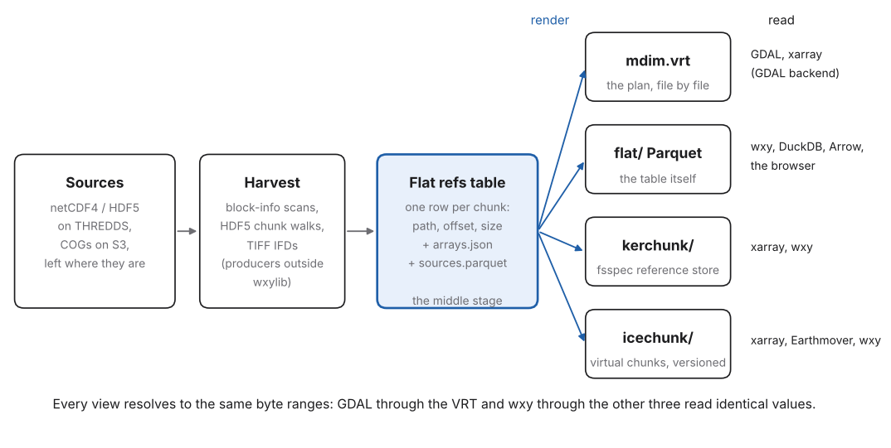

# m13: Four views of one byte table, and what a live store makes possible

Status: musing, 2026-10-21. An overview for review: how wxy and the
multi-view store fit together, where the proofs now sit, the next steps
that add the most value, and a set of uses to aim the work at. It does
not change any decision; anything here becomes work by being picked up
into a numbered document or [commit-criteria.md](commit-criteria.md).

## Summary

- A year of BRAN2023 daily ocean temperature (60 GB in twelve netCDF
  files on NCI THREDDS, 1,116,900 chunks) now has a live reference store
  with four views of one set of byte ranges: a GDAL mosaic VRT, the flat
  mdim-refs table, kerchunk Parquet and Icechunk. This is m02 at full
  size, built outside wxylib.
- wxy reads the flat, kerchunk and Icechunk views and gets the bytes GDAL
  gets from the VRT. A short Python reader with no format
  library, and a plain JavaScript page in the browser, get the same bytes
  from the flat table. The table is the interface; wxy is one good reader
  of it.
- The most valuable next steps are a permanent public home for the store
  (everything below gets easier), a CI-sized fixture of the same shape,
  and two small plan gaps in `wxy` the exercises found. A second dataset,
  GHRSST MUR COGs, already has the same four views and the same agreement
  with GDAL.
- The uses that would show the model off best are the ones that cross
  the store's grain: track and profile match-ups, sections, and heat
  content over regions, in several languages from one table.

## 1. wxy in one paragraph

wxylib takes ideas from GDAL that stand on their own (chunked warping,
resampling kernels, rasterization rules, virtual mosaics, range-request
I/O) and builds them as small Rust crates, each checked byte for byte
against GDAL. The `wxy` command warps, samples at points and summarises
under polygons, from COGs, Zarr and byte-reference tables, and every
command can print its plan (the chunks it fetches and what they cost)
without reading data. It is a reader and an operator. Producing tables is
someone else's code; the table format is a shared spec, not a wxylib
format ([commit-criteria.md](commit-criteria.md), rules).

## 2. The four views

| View | Gives | Costs | Best for |
|---|---|---|---|
| `mdim.vrt` | the plan: which file supplies which slab, in GDAL's own terms; provenance a person can read | GDAL to use (directly, or through GDAL's xarray backend); opens each source file's metadata | the oracle; GDAL users, and xarray users through GDAL; rebuilding everything else |
| `flat/` (mdim-refs Parquet) | the whole index as rows: queryable, joinable, any language with Parquet and HTTP | a reader per language (small: decode is zlib plus shuffle here) | wxy, DuckDB, R and Python without a format stack, the browser, cost models |
| `kerchunk/` | the fsspec reference store xarray already knows | Python-centred; one more rendering to keep in step | existing xarray workflows |
| `icechunk/` | versioned, transactional virtual Zarr; the Earthmover ecosystem | a repository format and its manifests; heavier than a table | publishing and evolving a dataset over time |

Two claims hold the views together:

- **One table, many projections.** Each view is rendered from the same
  rows (harvest, collate, middle, render, read). None is canonical except
  the middle stage, and the middle stage is a table, so any view can be
  regenerated and checked against any other.
- **Bytes, not structure.** Two views agree when they read the same
  values, not when they open with the same shape. Every claim here closes
  on a hash.

## 3. Where the proofs sit

| Step | Data | Result | Record |
|---|---|---|---|
| Table read as virtual Zarr | OISST, 30 days, one chunk per file | matches GDAL | m02; docs OISST walk-through |
| Table read directly, cache inside (S3c) | OISST fixture | matches GDAL and the Icechunk path | core `wxy-refs`; doc 03 S3c |
| Many chunks per file | BRAN2023, 32 days (97,920 refs) | read through Icechunk and directly | core example `bran_refs`; fixtures `mdimrefs/bran2023-temp-201001` |
| Live store, flat view, keyed S3 | BRAN2023, 365 days (1,116,900 refs) | two windows equal GDAL 3.14 on `mdim.vrt` | core #10, #11; fixtures #6, #7; design #26 |
| Live store, kerchunk view | same | same hashes | core #12 |
| Live store, Icechunk view | same | same hashes | live test of the store |
| No-library readers | same | same hashes from Python (Parquet, HTTP, zlib) and the same values in the browser | docs `examples/bran`; web `bran.html` |
| Second dataset, COG time stack | GHRSST MUR `analysed_sst` 2024 on source.coop: 366 daily COGs, (366, 17999, 36000), 512 x 512 tiles, 935,496 refs; harvested in 6 s with async-tiff | five windows identical to GDAL through `mdim.vrt` (GDAL and GDAL's xarray backend), zarr-python on kerchunk and Icechunk, and wxy on flat, kerchunk and Icechunk | core #13; GHRSST store thread |

Against the four commit criteria:

- **1 (reader, cache, BRAN against GDAL)** is met for BRAN; the CI-sized
  many-chunks fixture is still open.
- **2 (a producer wxylib does not own)**: the live store's table was made
  by an outside pipeline (R, rhdf5 and GDAL multidim), and wxylib reading
  it now matches GDAL. That is the second half of criterion 2 as written;
  the first half (producer rows equal to the fixture rows) is not shown.
  Whether the live store should count is a question for the criteria
  page, not settled here.
- **3 (R without Rust)**: not started. The no-library Python reader is a
  hint that the R answer may not need wxylib at all: `arrow` plus `curl`
  plus `memDecompress` reads this table. If that is enough for R users,
  criterion 3 may close by declaration.
- **4 (no new format)**: holding. The store added `sources.parquet`
  (source, size, mtime, etag), which the spec listed as missing; that is
  a spec column landing from the producer side, the right direction.

## 4. What the exercises showed

The [BRAN2023 example](https://wxylib.org/docs/examples/bran/README.html)
reads the store four ways. In short:

- **The table is a map before any data is read.** All-land chunks
  compress to 809 bytes, so land fraction by depth, information density
  by depth (bytes peak near 100 m, at the thermocline) and the cost of any
  read come from the `size` column alone.
- **Shape decides cost.** A global day at one depth is 60 requests and
  3.8 MB. A section along the equator is 612 requests and 38 MB to keep
  0.6% of what is decoded. A year at one place and four depths is 1,460
  requests and 131 MB to keep 1,460 numbers. THREDDS served about 1 MB/s
  to one client with 16 requests in flight.
- **Two gaps in `wxy`.** A `--dry-run` over a byte-reference table
  reports `stored_bytes: null`, though the table holds every size (doc
  03 lists real stored bytes as an S3c outcome). And there is no way to
  choose a subset of the leading dimensions (a day, a few depths) on the
  command line: a warp of this source is always the whole year, 18,615
  slices.
- **The browser needs no wasm for this.** THREDDS answers simple range
  requests with CORS and browsers send no preflight for them;
  `DecompressionStream` inflates. wxy-web earns its place when the page
  warps, not when it reads.

## 5. Next steps, by value

### 5.1 A permanent public home

The store moves to a public, stable location (source.coop is the
expectation). Write everything with the store URL as a parameter; the
docs example and the web page already take one.

- Get: anonymous reads, so the docs example runs for anyone and the web
  page can read `flat/refs_temp.parquet` itself (hyparquet or DuckDB-wasm
  with range reads) instead of a committed cut; citable URLs for each
  view.
- Cost: publishing is the store owner's step; wxylib only swaps a default.
- Without: every demo needs a key or a cut of the table, and the
  four-view story cannot be tried by the people it is for.

### 5.2 The CI fixture (criterion 1)

The synthetic Bluelink-shaped fixture (m06, section 2): a few small
netCDF4 files with many chunks each, all four views rendered, GDAL hashes
recorded. Closes criterion 1 in CI, and makes the four-view agreement a
test rather than a run log.

### 5.3 Two plan gaps in `wxy`

- `stored_bytes` from the table's `size` column in every plan over a
  byte-reference table. Small; it is what makes `--dry-run` a cost model.
- Leading-dimension selection for `warp`, `points` and `zonal` (an index
  or coordinate range per named dimension). Check first whether it belongs
  in the operation registry idea of m09 rather than as per-command flags,
  so that one selection grammar serves the CLI and the bindings.

### 5.4 A second dataset through the same views

GHRSST MUR sea surface temperature (daily COGs on source.coop) now has
the same four views for 2024, built in about a minute, and every reader
agrees with GDAL (section 3). It differs from BRAN in three ways that
belong in any overview:

- **The plan is a time stack of 2D files**, not a `gdal mdim mosaic` of
  netCDF: a vrtstack-style VRT. The four views stay the same; only the
  harvest and the plan's shape change.
- **The codec splits the readers.** Tiles are ZSTD with the TIFF
  horizontal predictor. The Zarr views carry a delta codec
  (`imagecodecs_delta` in v2, a horizontal delta codec in v3) that GDAL's
  Zarr driver cannot decode. So GDAL and GDAL's xarray backend read
  through the VRT, Python needs imagecodecs or virtual-tiff, and wxy needs
  its predictor crate. The views are equal in bytes, not in who can read
  them: a reason to keep all four.
- **The refs views are much faster to start.** GDAL's first read at a
  late time step through the VRT took about 2 minutes (it opens files in
  turn); the refs views took about half a second. The VRT stays the
  oracle and the plan, but not the interactive path.

Together the two datasets cover both harvest paths (HDF5 chunk walks and
TIFF IFDs) and both layouts (many chunks per file, one file per day). A
page that reads both from their tables with the same code would make the
model's main point without a word of explanation. The full GHRSST series
(about 8,900 days, about 22.8 million refs) is the first test of 5.5.

### 5.5 Scale: many years, many variables

BRAN2023 is daily from 1993: one variable is about 31 tables of this
size (6.5 MB and 1.1 million rows a year), and there are several
variables (temp, salt, u, v, eta). The questions that scale raises are
table questions, not reader questions: one file or partitioned by year
and variable, row group order for the common queries, and how the
"parquet-zarr-lite" layout carries the metadata. Measure with two or
three years before designing.

### 5.6 A companion chunking, rendered from the table

Sections and time series cost 100 to 300 times what they keep. Rather
than change the source, a render could write a time-chunked copy for a
region (or a cache warmed by `wxy-cache`), recorded as another view of
the same rows. Only worth it once a real time-series user exists.

## 6. Uses to aim at

### Interactive learning

- **The ocean in bytes.** A page that draws the `size` column as a map
  for any day and depth, then fills in the data as it arrives: a lesson
  in compression and information content that needs no explanation of
  netCDF.
- **Eddy watch.** The East Australian Current at a point, through depth
  and the year, with the cost of each click shown: why time series are
  expensive in a map-shaped archive, felt rather than told.
- **Thermocline slicer.** Draw a line on the map, get the section; the
  page reports how much it decoded to keep what it drew. Teaches
  chunking by making its cost visible.
- **Reanalysis against observation.** BRAN surface beside GHRSST for the
  same day, both from their tables, with a difference map.

### Deep analysis, any language

- **Animal tracks and floats.** Environmental values along tracks (seals,
  seabirds, Argo floats, gliders) by `wxy points` with time and depth:
  each chunk fetched once for all positions inside it. The classic
  tracking question, and the one the chunk grouping is best at.
- **Ocean heat content by region.** `wxy zonal` over marine regions or
  protected areas, weighted by cell coverage, per day and depth, then
  integrated over depth. One plan, every slice streamed.
- **Marine heatwaves.** Per-cell climatology and threshold exceedance
  over 30 years: the use that most needs the companion chunking (5.6),
  so the one that should decide whether to build it.
- **The table as data.** DuckDB SQL on the refs table itself: land masks,
  bytes by depth, anomalous chunks (a sudden size change can flag a
  processing change in the source), and plan costs before any read.
- **Each language at its natural level.** Python: xarray on the kerchunk
  or Icechunk view, xarray on `mdim.vrt` through GDAL's xarray backend, or
  the no-library reader. R: `arrow` on the table,
  or GDAL multidim on the VRT, or the `wxy` package later. Rust: `wxy`
  and its crates. JavaScript: the browser page. Julia: Zarr.jl on
  kerchunk. The same hashes in all of them is the cross-language test.

### Educational resources

- **Write your own reader.** A tutorial that builds the short reader
  step by step: what a chunk is, what HDF5 shuffle does, why a range
  request is enough. Ends by checking a hash against GDAL.
- **Make a store for your own archive.** A recipe from a folder of
  netCDF on a THREDDS server to the four views, using the outside
  producers, with the oracle check as the last step.
- **One dataset, five languages.** A set of short notebooks that ask the
  same question (a year at a place) and get the same numbers, each in its
  language's idiom; a teaching aid and a regression test at once.
- **Reading cost as literacy.** Every page and notebook shows requests,
  bytes fetched and bytes kept. Users learn the access pattern of their
  question before they learn any API.

## What do we get, what does it cost, what if we didn't

- Get: one picture of the model that a newcomer can follow, an honest
  map of what is proven and what is not, and a short list of next steps
  ranked by what they unlock; demos and uses that make the table, not
  wxylib, the thing people meet first.
- Cost: keeping section 3 in step with commit-criteria.md (the criteria
  page stays the one place status is kept; this page links to it), and
  resisting the uses that would grow wxylib past a reader and operator.
- Without it: the proofs stay scattered across PRs and run logs, the
  four views read as four competing formats, and the next step is chosen
  by whichever demo is nearest rather than by what it unlocks.
