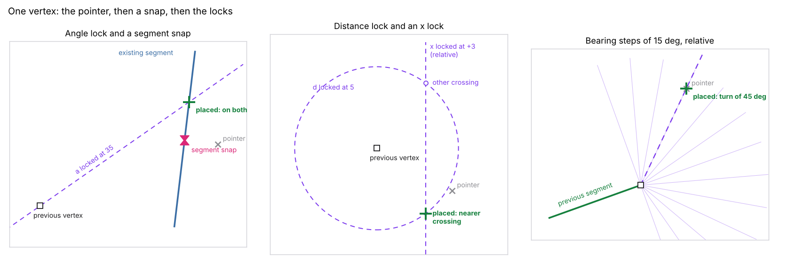
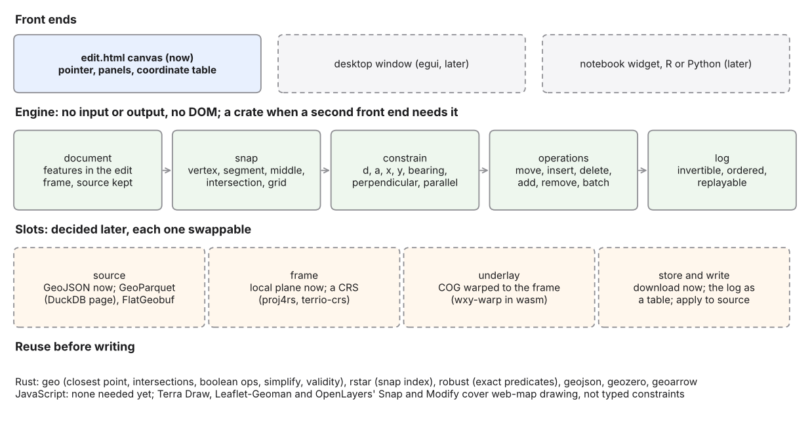
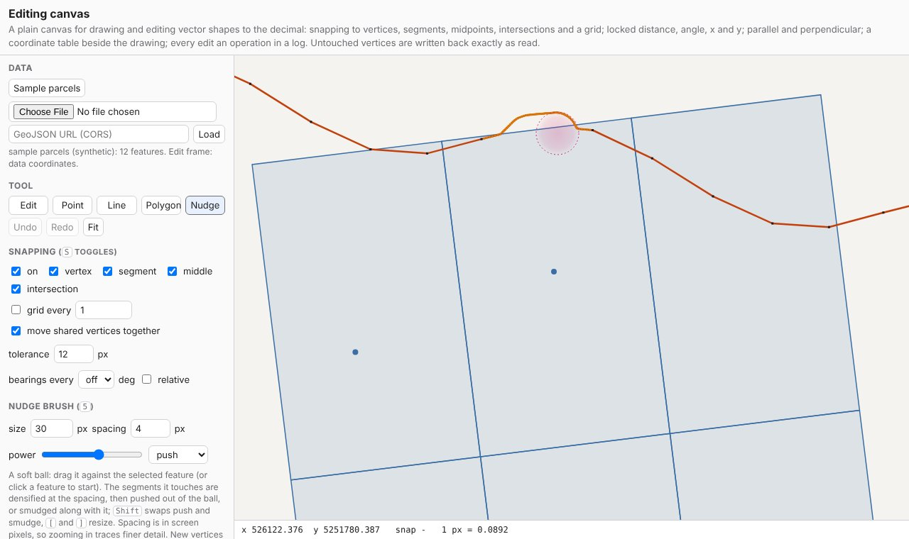

# m18: An editing canvas with CAD control

Status: musing, 2026-10-28. A personal canvas for drawing and editing
real vector data with the control CAD gives, read against Manifold,
QGIS, CAD and web drawing libraries; the editing primitives, a small
architecture that fits wxylib's layers and the web repo, and what to
reuse. A first prototype is built in wxylib/web (`www/edit.html`).
Open: six questions with recommended answers (section 9).

## Summary

- **What it is.** A map canvas that loads actual vector data and lets
  every vertex be placed exactly: snapped to existing geometry, typed as
  a value, or fixed by a geometric constraint (distance, angle,
  parallel, perpendicular). Not a GIS: no layer manager, styling system,
  processing toolbox or project format. How data is read, cached,
  stored, updated and written back is left open, as slots.
- **What prior art says.** Manifold and QGIS converge on the same three
  ideas: snapping that can be switched mid-gesture, a set of typed
  locks on the next vertex (QGIS: d, a, x, y, with relative and
  continuous variants), and a vertex list that is as editable as the
  drawing. CAD adds typed relative input and inferred alignments;
  parametric sketchers add constraints that persist; OSM editors treat
  an edit session as a changeset against a source. Web drawing libraries
  stop at snapping.
- **The core of it is small.** Snapping, one-shot constraints and an
  invertible operation log are about 500 lines of plain JavaScript with
  no DOM, tested under node. The canvas and panels are another 800.
  That is the case for writing it rather than adapting a library: no
  library found has typed constraint locks, and the parts that are
  hard (exact predicates, spatial indexes, boolean operations) already
  exist as Rust crates for when they are needed.
- **The wxylib angle.** Editing needs a planar frame (QGIS disables its
  CAD tools in geographic coordinates). Web maps fix the frame to Web
  Mercator; this canvas does not, so the edit frame can be any projected
  CRS, and `wxy-warp` in wasm can warp imagery into that frame as an
  underlay. Rendering is warping to a screen grid (m01, section 2.1),
  and the screen grid can be the edit frame.
- **Bytes in place, for vectors.** Features keep their source
  coordinates beside the frame ones; a vertex no operation touched is
  written back exactly as read, and the edit itself is a replayable log
  of operations against feature ids, a diff rather than a rewrite.
- **The grid meets the ground.** With a CRS the frame is a projection,
  and the canvas applies what surveyors apply: distances on the grid or
  on the ellipsoid (point scale factor, or the exact geodesic), angles
  from grid or true north (grid convergence), and edges as straight grid
  lines or as geodesics, drawn and snapped to as curves (section 5.4).
- **Recommended next.** Construction guides and typed relative input,
  then features from the GeoParquet page as a source. Port the engine to
  a Rust crate only when a second front end wants it.

## 1. The aim

A viewer for one person's own work: open a file of real features, look
at them over imagery or other features, and draw or reshape them with
finicky control. Finicky means: a vertex lands on another vertex, on a
segment, at a midpoint or on a crossing, not near one; a segment is
exactly 42 m, or exactly perpendicular to the road, or exactly on
x = 526100; and the numbers are always visible and always editable.

What it is not: a desktop GIS rebuilt. The point of m01 was that QGIS's
resources could be separate pieces; an editing canvas is one such piece,
and it is worth having alone.

Input and output are deliberately open. Where features come from, how
edits are cached, where they are stored, how they are reconciled with a
changed source and how they are written back are all "to be decided",
so the design keeps each behind a slot (section 5.3) and the prototype
fills each with the simplest thing that works (a GeoJSON file in, a
download out).

## 2. Prior art

Read as a guide to behaviour, not as code to follow. Nothing here is
copied from an implementation.

### 2.1 Manifold (release 9)

- **Geometry is a field in a record.** Editing an object is editing a
  record: changes are pending until committed (Update Record, Ctrl-Enter)
  or abandoned (Ctrl-Backspace). An edit is a small transaction.
- **Edit modes** switched by key during editing: Move Coordinates (M),
  Insert Coordinates (I), and a Move Coordinates plus Split mode (P).
- **A coordinate list beside the drawing.** The Coordinates tab of the
  Info pane lists every vertex of the object in order; vertices can be
  selected in either the list or the drawing, and edited in either.
- **Snap modes switched mid-gesture by key**: Space toggles snapping;
  C snaps to coordinates (vertices), G to a virtual grid (10 by 10 units
  by default), B to bearings (a number of divisions, default 4, so 0, 90,
  180 and 270), R to bearings relative to the last segment, and A
  switches between the active layer and all visible layers.

### 2.2 QGIS (advanced digitizing and snapping)

- **The Advanced Digitizing panel**: fields d (distance), a (angle),
  x, y, z and m, each with a lock. A key sets a value (D, A, X, Y),
  Ctrl or Alt with the key locks it, Shift with it toggles relative (to
  the last vertex for coordinates, to the last segment for angles).
  Locks release after each vertex unless set to continuous.
- **Construction mode** (C): clicks record reference points that are not
  vertices, so a lock can be measured from them; recorded construction
  guides are drawn and can be snapped to.
- **Parallel and perpendicular** (P): pick a segment, and the angle locks
  to it. **Common angles** (steps of 0.1 to 90 degrees, cycled with N),
  absolute or relative. **Construction tools**: a line's extension and a
  vertex's x or y alignment become snappable guides (and their
  crossings). A **2-circle intersection** places a vertex where two
  circles of given centres and radii meet.
- **A floater** that follows the cursor showing distance, angle,
  coordinates, bearing, area and perimeter.
- **Snapping** to vertices, segments, areas, centroids, segment middles,
  line endpoints and intersections; tolerance in pixels or map units;
  per-layer settings, scale limits, self-snapping and a per-layer
  precision grid. **Topological editing** moves shared vertices
  together; **avoid overlap** clips new polygons against neighbours;
  **tracing** follows existing features.
- The CAD tools are **disabled when the map is in geographic
  coordinates**: precise distance and angle need a planar frame.

### 2.3 CAD

AutoCAD-style drafting adds three things GIS tools mostly lack: object
snaps that are inferred rather than present (apparent intersection,
extension, perpendicular from, tangent), polar tracking that offers
alignment lines from points the cursor has visited, and typed input of
relative coordinates (`@dx,dy`, `@distance<angle`) at a command line,
so a drawing can be built from the keyboard alone.

### 2.4 Parametric sketchers

FreeCAD's Sketcher (its solver, planegcs) and SolveSpace (its solver
library) keep constraints after placement: a segment stays horizontal,
two segments stay equal, and moving one point re-solves the rest. GIS
tools apply constraints once, at placement. Persistent constraints are
the larger idea and the larger cost (a solver, degrees of freedom,
conflicts); both solvers are standalone libraries that could be bound
if it ever comes to that.

### 2.5 OpenStreetMap editors

JOSM and iD edit a local copy and upload a changeset; JOSM resolves
conflicts against a changed server copy. The useful idea is the edit as
a diff against a named source, with its own identity, rather than a new
file.

### 2.6 Web drawing libraries

Terra Draw (one drawing layer over Leaflet, MapLibre, OpenLayers and
other map libraries), Leaflet-Geoman, mapbox-gl-draw and OpenLayers'
Draw, Modify and Snap interactions cover drawing on web maps with vertex
and edge snapping. None found offers typed locks on distance, angle or
coordinates, and all draw on the map library's frame, which is Web
Mercator for most.

### 2.7 Brushes that reshape

Landscape Mapper had a Nudge tool: a soft ball, sized and weighted to
taste, that densified a segment as it touched it and let the line be
pushed into shape, which suits tracing fine detail far better than
placing vertex after vertex. Inkscape's Tweak tool is the same family in
a drawing program (push, shrink and roughen modes, with a width and a
force). The idea for this canvas: a brush is an operation on a ring
like any other, so it lands in the log as one reshape per stroke.

### 2.8 What to take

| Idea | From | Taken |
|------|------|-------|
| Snap kinds switched by key mid-gesture | Manifold, QGIS | yes, prototype |
| Typed locks on d, a, x, y; relative; release after each vertex | QGIS | yes, prototype |
| Parallel and perpendicular from a picked segment | QGIS | yes, prototype |
| Bearing steps, absolute or relative | Manifold, QGIS | yes, prototype |
| Vertex list as editable as the drawing | Manifold | yes, prototype |
| Shared vertices move together | QGIS (topological editing) | yes, prototype (exact coincidence) |
| Construction guides and reference points | QGIS, CAD | next |
| Typed relative input (`@dx,dy`, `@d<a`) | CAD | next |
| Inferred alignments (extension, x or y of a visited vertex) | QGIS, CAD | next |
| Edit as a pending transaction on a record | Manifold | as the operation log |
| Edit session as a diff against a source | OSM editors | as the operation log |
| A nudge brush that densifies as it pushes | Landscape Mapper, Inkscape | yes, prototype |
| Persistent constraints with a solver | Sketchers | later, if ever |

## 3. The editing primitives

Grouped by what the person does, with where each stands.

| Group | Primitive | Status |
|-------|-----------|--------|
| Place | snap to vertex, segment, middle, intersection, grid; pixel tolerance; glyph per kind | prototype |
| Place | lock distance, angle, x, y; relative x, y and angle; keep locks | prototype |
| Place | bearing steps (absolute or relative); angles as math or as bearings | prototype |
| Place | angle from a picked segment: parallel, perpendicular | prototype |
| Place | construction points and guides; snap to guides | next |
| Place | typed relative input at a command line; keyboard nudge by a typed delta | next |
| Place | inferred snaps: extension, apparent intersection, x or y alignment, perpendicular from, centroid, endpoints | next |
| Place | two-circle and circle-line intersections from typed radii | later |
| Reshape | move, insert (midpoint drag, double click), delete vertex | prototype |
| Reshape | shared vertices move together | prototype |
| Reshape | nudge brush: densify what the ball touches (spacing in screen pixels), push out of the ball or smudge along; size, spacing, power | prototype |
| Reshape | brush variants: smooth, simplify under the brush, pull toward a snapped target | later |
| Reshape | insert into a neighbour's shared segment (topological insert) | next |
| Reshape | select many vertices; move, rotate, scale by typed values | next |
| Reshape | split a line at a vertex; merge; reverse; close and open | next |
| Reshape | offset (parallel copy), fillet and chamfer, simplify | later (geo) |
| Create | point, line, polygon | prototype |
| Create | rings (holes) and parts; rectangle, circle, regular polygon from typed values | next |
| Create | traverse entry: a list of bearing and distance legs (survey style) | later |
| Read | coordinate table, full precision, editable | prototype |
| Read | live d, a, x, y; area and length (planar) | prototype |
| Read | ellipsoidal area and length; validity flags (self-intersection, ring order) | next (geo) |
| Record | every edit an invertible operation; undo, redo; log as JSON lines | prototype |
| Record | attribute edits as operations | next |

## 4. One vertex: pointer, snap, locks

Every vertex that is placed, by a click or at the end of a drag, goes
through the same two steps, and the canvas shows both while the pointer
moves:

1. **Snap.** Candidates within the tolerance, best first by kind
   (vertex, intersection, middle, segment), then by distance; a grid, if
   on, when nothing else is near. Vertices and segments being dragged
   are excluded, and the shape being drawn is included (self-snapping).
2. **Constrain.** The snapped point (or the bare pointer) is moved onto
   whatever the locks allow, measured from the previous vertex:
   - x and y both locked: that point.
   - an angle (locked, or from bearing steps) gives a line: with d
     locked, the point at that distance; with x or y locked, the line's
     crossing; with a segment snap, the crossing of the line and the
     segment; otherwise the pointer projected onto the line.
   - d locked without an angle gives a circle: crossed with an x or y
     lock, or with a snapped segment, the crossing nearer the pointer;
     otherwise the pointer projected onto the circle.
   - x or y alone replaces that coordinate.

The combinations are what make it feel exact: "perpendicular to the
road, ending on the road" is an angle lock picked from the road plus a
segment snap on the road, and the vertex lands on the crossing, not
near it.

## 5. Architecture

### 5.1 Engine

No input or output, no DOM, no map library. Five pieces:

- **document**: features as rings in the edit frame, each vertex beside
  its source coordinates (kept until an operation touches it);
- **snap**: candidates from the document near a point;
- **constrain**: section 4, a pure function of the pointer, the previous
  vertex, the previous direction, the locks and the snapped segment;
- **operations**: move, insert, delete, add, remove, batch and reshape
  (a ring replaced whole, as a brush stroke does), each a plain object
  with an exact inverse;
- **log**: the applied operations in order; undo and redo walk it, and
  replaying it over the source gives the edited features.

This follows wxylib's layer rule (planning and computing apart from
reading), and it is the same split as `wxy-web`'s `render.rs` (no
JavaScript, tested natively) against `lib.rs` (the wasm surface).

### 5.2 Front end

The canvas: screen transform, pointer handling, drawing, panels, the
coordinate table and keys. It owns nothing the engine needs. A second
front end (a desktop window in egui, a notebook widget) would reuse the
engine and replace only this.

The canvas is its own Canvas 2D surface, not a Leaflet or MapLibre map.
The GeoParquet and Sentinel-2 pages use Leaflet, which fixes the frame
to Web Mercator; editing wants a planar frame chosen for the data, and a
plain canvas costs a page of pan and zoom code.

### 5.3 Slots

Each slot has a trivial filling now and a list of candidates; none is
decided.

| Slot | Now | Candidates |
|------|-----|------------|
| Source | a GeoJSON file or URL | the GeoParquet page's query result (DuckDB-wasm); FlatGeobuf over ranges; a feature table from a wxylib reader |
| Frame | a data CRS and an edit CRS through proj4rs in wasm (`Transform` in `wxy-web`); a local plane for longitude and latitude with no edit CRS | terrio-crs as a second backend; PROJ in wasm for datum grids |
| Underlay | a COG warped to the edit frame by `wxy-warp` in wasm (`Cog`) | several COGs or a mosaic; other features read only |
| Store and write | download the edited GeoJSON and the log | the log in browser storage (OPFS); the log as a table (one row per operation); apply to the source (GeoJSON rewrite, GeoParquet rewrite of touched row groups, a database) |

The store slot is where the bytes-in-place idea lands for vectors. The
source stays as it is; the edit is the log, keyed by feature id, ring
and vertex index. Writing back can be "source plus log" (replay on read)
as well as a rewrite, and a rewrite touches only edited vertices: the
prototype writes untouched vertices back exactly as read, z values
included, even when the edit frame is a projection of longitude and
latitude.

### 5.4 The frame meets the ground

A projected frame is a plane that is not the ground. At any point the
projection stretches lengths by the point scale factor k and turns
directions by the grid convergence (the angle from true north to grid
north). Survey practice reduces between the two all the time ("grid
distance" and "ground distance", "grid bearing" and "true bearing");
GIS editing tools mostly leave the user in the grid.

The canvas makes the choice explicit, with three switches that the
constraint step (section 4) honours:

| Switch | Grid | Ground |
|--------|------|--------|
| distances | a locked d is frame units | a locked d is metres on the ellipsoid: d times k at the previous vertex, or the exact geodesic point when the angle is also locked |
| north | a locked angle or bearing step is a grid direction | it is a true azimuth: the convergence at the previous vertex is applied |
| edges | a segment is the straight grid line between its vertices | a segment is the geodesic between them: drawn as a curve, snapped to along the curve, and split at the geodesic middle |

k and the convergence are not taken from projection formulas: they are
measured at the point, by stepping a metre along a direction and asking
the ellipsoid (Vincenty's solutions on WGS84) how far and which way
that went. That works for any CRS proj4rs can transform, conformal or
not, and it is the same check a surveyor makes. The readout shows grid
distance and angle beside ground distance and true azimuth, and k and
the convergence at the pointer.

Exported vertices are vertices: an edge drawn as a geodesic is still two
vertices in the GeoJSON, and what the edge means (grid line, geodesic,
or a loxodrome, not offered) belongs with the data's description, not
in extra vertices.

### 5.5 Where it sits in wxylib

In wxylib/web, as a page beside the others, sharing their style and
landing card. It imports the same `wxy_web.js` the COG page uses, for
CRS transforms and the underlay, and still edits without it (data
coordinates or a local plane). Nothing in wxylib/core changes. If the engine becomes a crate
(question 2), it is geometry with no geospatial dependency beyond
`geo-types`, which makes it a candidate for its own repository rather
than a `wxy-` crate, in the spirit of m09's modules that do not exist
yet.

## 6. Reuse or write

The check before building: does this exist?

- **Snapping, typed constraints and an operation log, as a headless
  engine.** None found, in Rust or JavaScript. Web libraries (2.6) have
  snapping inside their map adapters; QGIS and Manifold have the
  behaviour inside their applications; CAD kernels (Rust: fornjot,
  truck) model 3D solids and are far larger than this needs. Write, and
  keep small.
- **Geometry underneath.** Exists. In Rust: `geo` (closest points,
  intersections, boolean operations through `i_overlay`, simplify,
  validity, geodesic measures), `rstar` (an R-tree for snap candidates
  once data grows past brute force), `robust` (exact orientation
  predicates), `geojson`, `geozero` and `geoarrow` for formats. Reuse
  when the engine moves to Rust.
- **Drawing on a web map.** Exists (2.6), but frame-bound and without
  typed constraints. Not used; revisit if a slippy-map basemap in Web
  Mercator becomes the main use.
- **Persistent constraints.** Exist as solvers (2.4). Not needed for
  one-shot placement.
- **Reading and querying features.** Exists (DuckDB-wasm, the GeoParquet
  page; m09, section 6). Reuse as a source.

What it costs to write: the prototype is about 500 lines of engine and
800 of canvas, in plain JavaScript with no dependencies. What if we
didn't: the editing behaviour stays inside QGIS or Manifold, and no
piece of it is usable from a browser page, a notebook or a script.

## 7. The prototype

`www/edit.html` in wxylib/web, with `www/edit-core.js` (the engine),
`www/edit-geo.js` (geodesics, convergence, scale factor) and
`www/edit.js` (the canvas). It opens on a synthetic sample (six parcels
sharing boundaries on a block turned 7 degrees, a road, a creek and four
trees, in UTM zone 55 south over Hobart) so it runs with no network, and takes any
GeoJSON by file, drop or `?url=`.

What it does is the "prototype" rows of section 3 and the switches of
section 5.4. The engine has seventeen tests under node, run in the web
repo's CI: exact round trips (z kept),
local-frame edits that leave untouched longitude and latitude bit for
bit, snap priority, each lock and their combinations, both angle
conventions, batch operations, the nudge brush (densify, push to the
rim, smudge falloff), Vincenty against its published example, the
convergence and a true-north, ground-distance lock on a turned plane,
snapping along a geodesic edge, and undo and redo restoring geometry and
source. The canvas was driven headless: a vertex dragged under a 45 m
distance lock lands 45.000 m from its neighbour, shared corners move
with it, a line drawn with the angle picked from the road meets it at
90 degrees, a coordinate typed into the table moves the vertex and
undoes, and a MultiPolygon with a hole in longitude and latitude comes
back identical after an edit and its undo. With the CRS switches, a
line locked at true north and 50 m on the ellipsoid from a parcel corner
in UTM 55 south comes out 49.98 m on the grid (k 0.99961) at grid
bearing 0.218 degrees (the convergence); the same data reframed to south
polar stereographic still exports its untouched vertices unchanged; and
the Sentinel-2 scene warps into either frame (two range requests,
2.4 MB, at full resolution).

Known limits: brute-force snapping (fine to some tens of thousands of
vertices), no attribute editing, no datum shifts (proj4rs, no grids), shared vertices found by
exact coincidence only, and the local plane is an approximation (a few
parts per thousand across a city), labelled as such on the page.

The nudge brush pushing a bend into the creek. The spacing is in screen
pixels, so the same stroke zoomed in adds finer vertices; new vertices
the stroke did not move are dropped when it ends:

## 8. Next steps, by value

Done since the first draft: the underlay, a frame from a CRS, and the
grid-and-ground switches (section 5.4).

1. **Construction guides and typed relative input**: reference points
   that are not vertices, guides that can be snapped to, and a one-line
   command box taking `@dx,dy` and `@d<a`.
2. **Topological insert and multi-vertex selection**: inserting into a
   shared segment inserts into both features; move, rotate and scale a
   selection by typed values.
3. **A source from the GeoParquet page**: open a query result in the
   canvas, with feature ids from the source rows, so the log is keyed to
   them.
4. **More ground**: loxodromes as a third edge model; geodesic areas
   and lengths in the feature panel; a traverse entered as true bearings
   and ground distances (survey style) closing with its misclose shown.
5. **The log as a table**: one row per operation, kept in browser
   storage between visits, downloadable as Parquet. Only then think about
   writing back to a source.

## 9. Questions

1. **The edit frame.** Always planar: projected data in its own
   coordinates or a chosen edit CRS, longitude and latitude in a local
   plane when none is chosen. Recommended: yes; never edit in degrees.
2. **Where the engine lives.** Recommended: JavaScript in wxylib/web
   while the operation set is settling; a Rust crate (on `geo` and
   `rstar`) when a second front end wants it, probably in its own
   repository rather than as a `wxy-` crate.
3. **One-shot or persistent constraints.** Recommended: one-shot, as
   GIS tools do; persistent constraints only if a real need appears, and
   then through an existing solver.
4. **The write path.** Recommended: the log is the edit; "source plus
   log" and "rewrite touched vertices only" are both valid write-backs,
   and neither is chosen until a real source is being edited.
5. **The underlay.** Recommended: imagery warped to the edit frame by
   `wxy-warp`, rather than a Web Mercator tile basemap; tiles only if a
   basemap for orientation is wanted, drawn read-only in the same frame.
6. **The map library.** Recommended: none for the editing view; a plain
   canvas keeps the frame free.
