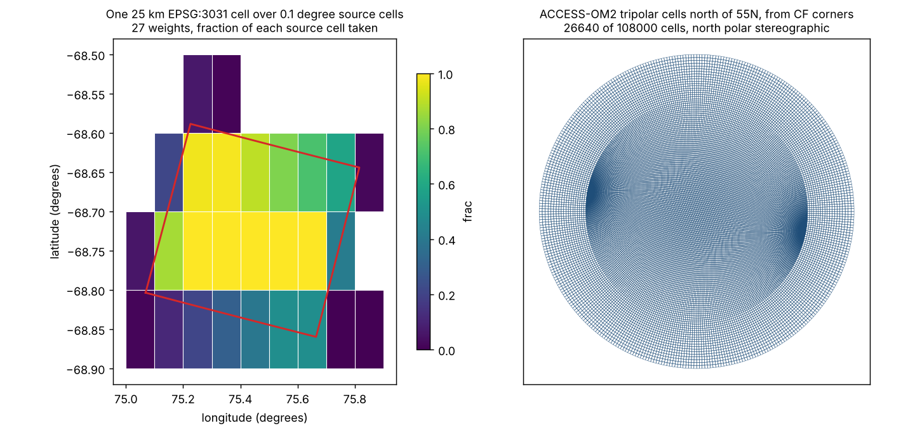

# m21: Conservative regridding in wxylib: examples, docs and use

Status: musing, 2026-10-29. Plans the wxylib side of rwarp's general
conservative regridding: which examples show it, how it fits the docs
that exist, and how wxy-warp, the CLI, the bindings and the browser use
it. Based on hypertidy/rwarp at 87f9b42 (0.3.1 plus the ESMF oracle
suite), rwarp's `design/conservative.md` and
`design/curvilinear-frontend.md`, m19, m20 (section 8 sets the weight
files and the CLI verb) and wxylib/core at caba7b2. Measurements:
[measurements/m21-conservative](../measurements/m21-conservative/README.md).
Figure: `scripts/m21_figures.py`.

## Summary

The question: rwarp is growing from an exact-footprint average into a
general first-order conservative regridder (weights as values, an ESMF
oracle, then a spherical measure, curvilinear and periodic grids, meshes
and second order). What should wxylib show with it, where does it sit in
the docs, and what does wxylib build on it?

- **Not overbuilding.** No Rust crate computes conservative weights, and
  none of ESMF, xESMF, CDO, TempestRemap or xarray-regrid is light,
  wasm-capable and driven by any transformer GDAL can describe. rwarp is
  the home for the numbers; wxylib adds files, a verb and examples, as
  m20 section 8 already decided. This note does not reopen that.
- **Six examples, in rwarp's stage order.** Two can be built now on real
  data the project already reads: GHRSST MUR 0.01 degree onto 0.25
  degree, and BRAN2023 0.1 degree onto polar stereographic over Prydz
  Bay. Then a tripolar ocean model grid with CF corners (ACCESS-OM2 from
  CMIP6 on public cloud, checked reachable), a swath with centres only,
  polygons as a mesh (the existing zonal example seen as weights), and a
  browser page that shows one target cell's weights.
- **Two findings from measuring the first two.** Weights for a coarsening
  pair grow as the square of the ratio: 650 entries per target cell at
  0.01 to 0.25 degree, so a global table would be about 675 million
  entries (16 GB), where the same weights factor exactly into two
  one-dimensional tables of about 54,000 entries. And 2 to 5% of entries
  are floating-point slivers below 1e-9 of a source cell; files should be
  written with a stated drop tolerance.
- **One new explainer, edits to five pages.** A conservative-regridding
  explainer becomes the concept page; the non-affine example's three
  choices (cell, edge model, measure) become its vocabulary; rwarp's book
  stays the API page. Explainers, examples and testing pages get one link
  or section each, not new copies.
- **wxylib uses it in four places:** a `weights` module in wxy-warp over
  wxy-domain grids, `wxy weights` and `wxy warp --weights` (m20), weights
  as an Arrow table in the bindings (xESMF, scipy, R's Matrix), and a
  wasm page. Weights are also a read plan: the source cells a target
  band needs are known before a byte is read.

## 1. Where rwarp stands

Stages 1 and 2 of rwarp's `design/conservative.md` have landed.

| Stage | Content | State |
|---|---|---|
| 1 | `exact_weights`, `Weights`, `FracArea`/`DestArea`, `apply`, `esmf_row_col` | rwarp#22, in 0.3.1 |
| 2 | ESMF oracle suite: six cases, Cartesian and spherical | rwarp#24, #25: Cartesian matches ESMF to 2e-12 in S, `frac_b`, area and field; spherical S differs by 6e-4 to 6e-3, recorded as ceilings |
| 3 | spherical measure (change of integrand in the window), great-circle edges via bigcurve | planned |
| 4 | curvilinear and periodic grids (`QuadMesh`, `CellMap::EqualArea`, `Topology::Tripolar`) | planned, `design/curvilinear-frontend.md` |
| 5 | meshes (faces burned by controlledburn) | planned |
| 6 | second order | planned |

The measure until stage 3 is planar area in source pixel space. For a
regular lon/lat source that is lon/lat area, which is not area on the
sphere; the spherical ceilings measure the difference.

In wxylib, only `wxy warp -r average --exact-footprint N` touches any of
this (wxy-warp passes `Footprint::Exact` to rwarp). Nothing in core calls
`rwarp::weights` yet.

## 2. Is this overbuilding?

| Tool | What it does well | Why it does not fill the gap |
|---|---|---|
| ESMF / ESMPy, `ESMF_RegridWeightGen` | the reference: grids, meshes, great circles, MPI | Fortran and C++, a large build, no wasm, its own grid objects |
| xESMF | the Python face of ESMF, weights reusable as files or Datasets | needs ESMF; xarray only |
| CDO, NCO `ncremap`, TempestRemap | command-line remapping, high-order methods (TempestRemap) | C/C++ tools, netCDF in and out |
| xarray-regrid | conservative for rectilinear grids, factored per axis | Python, rectilinear only |
| iris `AreaWeighted`, pyresample bucket | area-weighted means on rectilinear grids, binning | not general, Python |
| GDAL `-r average` | everywhere | the box footprint, not conservative (m19) |

A crates.io search on 2026-10-29 for regrid, regridding, conservative
remap and ESMF found nothing relevant. The gap is the combination: exact
weights from any transformer GDAL can describe (projected, rotated,
geolocation arrays), as a table, verified against ESMF, in a library
small enough to compile to wasm. That belongs in rwarp (m20 section 4.1).
wxylib needs no new crate for it: the `weights` module goes in wxy-warp,
and the Parquet layer moves to its own crate only if a second consumer
appears (m20 section 8.4, m09 section 5).

What wxylib should not build: an ESMF-style grid object model, a mesh
format zoo before a mesh case is asked for, or a `regrid` verb (m20
section 8.2).

## 3. Examples

Each example is a docs page with one figure and one check, built on data
the project already reads where possible. The table is in build order.

| | Pair | Shows | Check | Needs |
|---|---|---|---|---|
| E1 | GHRSST MUR 0.01 degree to 0.25 degree lon/lat | compute once, apply to a year from the byte table; box against exact; separable weights | xESMF `conserve_normed` on the same pair (m20 section 8.3's real-data case); global integral | now (rwarp 0.3.1); m20 8.4 steps 1 and 2 |
| E2 | BRAN2023 0.1 degree to EPSG:3031 at 25 km, Prydz Bay | a projected target where box and exact differ most (m19); planar against spherical | ESMF spherical and Cartesian on the same pair; source-side conservation | now; spherical comparison sharpens at rwarp stage 3 |
| E3 | ACCESS-OM2 1 degree tripolar (CMIP6 `tos`, CF corners) to 1 degree lon/lat | a curvilinear source with corners, the north fold, ESMF's own definition of a cell | ESMF Cartesian twin (zero difference), ESMF spherical, the model's `areacello` | rwarp stage 4 (`Tripolar`), stage 3 for areas in m2 |
| E4 | a swath with centres only (GHRSST L2P or a geolocation-array fixture) to a regular grid | the cell-from-centres choice, the 0.75% of docs#14, binning L2 to L3 | ESMF with corners derived from centres; nearest-bin counts | rwarp stage 4 (`EqualArea` from centres) |
| E5 | polygons as a mesh: the zonal example's polygons to the grid, transposed | `wxy zonal --coverage` is mesh-to-grid weights; xESMF `SpatialAverager` equivalence | xESMF `SpatialAverager` on the same polygons | rwarp stage 5, or now as a table from controlledburn |
| E6 | browser: hover a target cell, see its source cells and fractions | the weights as a thing to look at; any CRS pair proj4rs knows | values equal to the native run on one fixture | now (rwarp-wasm with `proj4rs`) |

### 3.1 E1, GHRSST MUR onto a quarter degree

The 2024 byte table (examples/ghrsst) gives 366 days of a 0.01 degree
global field. Weights for 0.25 degree are computed once and applied to
every day; the page shows the cost of the weights beside the cost of the
366 applications, a map of box minus exact for one day, and the 2024
mean against xESMF's. The measurement on a 20 by 10 degree window (the
Tasman Sea) gives 2.08 million entries for 3,200 target cells in 0.08 s,
every one of the 2 million source cells summing to 1 within 1e-9, and
the largest sum over 1 by 2e-15.

This pair is where the table form is wrong. The grids are nested, so 625
entries per target cell is the true count, and a global table would be
about 1.04 million target cells times 650, 675 million entries or 16 GB.
For two regular grids in one lon/lat CRS (or any two grids whose axes
are aligned), the overlap of a target cell with a source cell is the
product of the overlaps along each axis, and that stays true for the
spherical measure of lon/lat-straight edges, `(l1 - l0)(sin p1 - sin p0)`
per cell. So the weights are two one-dimensional tables: about 1,440 x 26
plus 720 x 26 entries globally. This is what xarray-regrid does. It is a
rwarp question (a `SeparableWeights` beside `Weights`, recognised when
both transformers are axis-aligned), and a wxylib one only in that the
Parquet schema records which form it holds (section 6.2).

### 3.2 E2, BRAN2023 onto polar stereographic

examples/bran section 6 already warps Prydz Bay to EPSG:3031 with
bilinear. The conservative version is the same command with
`-r average --exact-footprint 4`, then `wxy weights` and
`wxy warp --weights` for the year. The figure's left panel is one target
cell from the measurement: 27 source cells, with fractions from 8e-17 to
1. On the 72 by 72 window, densify 1 and 4 give 13.5 and 13.3 entries per
target cell, source sums within 1e-9 of 1 for every fully covered source
cell, and the largest sum over 1 by 3e-14. 3,428 (densify 1) and 2,645
(densify 4) entries are below 1e-9 of a source cell, 5% and 4%; these are
slivers where an outline touches a cell along an edge (section 6.2).

This is also the page for the planar-against-spherical difference: ESMF
spherical on the same pair, and the stage 2 ceiling for `lonlat_3031`
(S within 6e-3) shown as a map, to be redrawn when rwarp's spherical
measure lands.

### 3.3 E3, a tripolar ocean grid

The CMIP6 archive on Google Cloud publishes ACCESS-CM2's ocean (the
ACCESS-OM2 1 degree tripolar grid, 300 x 360) as Zarr with
`vertices_latitude` and `vertices_longitude` (four CF corners per cell)
and `areacello`. It was reachable from the cloud container on 2026-10-29
(the figure's right panel reads it), it is Blosc-compressed Zarr v2,
which wxy-zarr reads through zarrs, and it is the same grid as Australian
ocean model output, so it suits the project. The check has three parts:
the ESMF Cartesian twin, which must agree to rounding (as rwarp's stage
2 cases do); ESMF spherical, a recorded difference; and the sum of
rwarp's spherical source areas against the model's own `areacello`, an
oracle that is neither GDAL nor ESMF. NEMO's ORCA grids are the same
shape of problem if a second case is wanted.

### 3.4 E4, a swath from centres

Swaths (L2 satellite products) give cell centres only. docs#14 measured
the cell definition's effect against ESMF: up to 0.75% of a cell between
corners derived from centres and the bilinear outline. This page states
the choice the user makes (`--cell centres` with the equal-area map, or
derived corners) and shows both against ESMF. It reuses the
geolocation-array fixtures rwarp and wxylib already have.

### 3.5 E5, polygons as a mesh

`wxy zonal --coverage` burns polygons with controlledburn and keeps
(polygon, cell, fraction). That table, divided by polygon area, is the
grid-to-mesh weights of rwarp's stage 5, and it is what xESMF's
`SpatialAverager` computes. The examples/zonal page gains a short section
saying so, with the xESMF comparison, and `wxy zonal` can write its
fractions in the weights schema once that exists (no new verb). This is
an explanation more than a new feature.

### 3.6 E6, a page for one cell's weights

A wxylib/web page, in the pattern of the editing canvas and the warp
demo: choose a source grid and a target grid (CRS and extent), compute
the weights in a worker with rwarp-wasm and `proj4rs`, and on hover draw
the target cell's outline over its source cells with their fractions, as
in the figure. It costs little, needs no data, and is the easiest way to
show what a weight table is. It also exercises rwarp's `weights` in wasm,
which nothing else does yet.

## 4. How this relates to the existing docs

Status and API stay where they live now (one place per audience): the
rwarp book's "Conservative weights" guide is the API page, design doc 03
is the stage record, and the docs README is the user view.

| Page | Change |
|---|---|
| new `explainers/conservative.md` | the concept page: what first-order conservative remapping computes, `frac` and `dst_area`, the two normalisations (ESMF `fracarea`/`destarea`, xESMF `conserve_normed`/`conserve`), why shared edges make it conserve, the three choices (cell, edge model, measure), separable weights; one figure (a target cell over its source cells); how the match with ESMF is tested |
| `explainers/index.qmd` | the intro says explainers cover GDAL mechanisms; add "and the methods wxylib takes from elsewhere" and list the new page |
| `explainers/kernels.md` | the average section links to the new page: GDAL's average is the box footprint, exact average is conservative |
| `explainers/warper.md` | the exact footprint's place in the warp, one paragraph and a link |
| `explainers/geoloc.md` | after rwarp stage 4: the equal-area cell map for coverage beside the bilinear map for points |
| `explainers/rasterize.md` | coverage fractions section: the same engine gives mesh weights (E5) |
| `explainers/testing.qmd` | ESMF as the second oracle: identity against the Cartesian twin, recorded ceilings for spherical |
| `examples/nonaffine` | stays as the measured experiment; a closing note that its three choices are now options in rwarp, linking the new explainer |
| `examples/zonal` | section for E5 |
| `examples/ghrsst`, `examples/bran` | E1 and E2 as new sections (or their own pages, if long) |
| `capabilities` map | rows for weights, `wxy weights`, `--weights`, and per-stage capabilities as they land |

E3 and E4 get their own example pages when rwarp stage 4 lands; until
then they are not mentioned on the site.

## 5. How wxylib uses it

### 5.1 wxy-warp

A `weights` module with two functions:

- `weights_for(src: &Grid, dst: &Grid, opts) -> rwarp::weights::Weights`,
  taking wxy-domain grids (affine, rectilinear, geolocation arrays, CF
  corners) and building the transformer rwarp needs, as `warp` does now.
  This is where wxylib's grid descriptions meet rwarp's cell definitions.
  wxy-domain has a corners slot (for meshes and grid corners); CF
  `bounds` read from Zarr or netCDF need to reach it, and the cell
  definition is then chosen from what is present, with the choice
  recorded.
- `apply` over slices: the existing per-slice loop of `wxy warp` with
  `Weights::apply` in place of `warp`, so every time step and depth level
  reuses one table.

**Weights are a read plan.** For a target tile, the entries in its row
band name every source cell it needs, so the chunk set is exact before a
byte is read (m05, m13). `wxy warp --weights --dry-run` can list chunks
from the weights rather than from a footprint estimate, and with a byte
table that is the exact byte ranges per target tile.

### 5.2 CLI

As m20 section 8.2: `wxy weights SRC <target args>` writes the table, and
`wxy warp SRC --weights FILE` applies it. Additions from this note:

- `--drop-tolerance` (default 1e-9 of a source cell, recorded in the
  file): section 3's slivers.
- `--normalize fracarea|destarea` on `warp --weights` (choice at apply
  time, since the file is unnormalised), not only on the ESMF export.
- After rwarp stage 3: `--measure planar|spherical`. After stage 4:
  `--cell corners|centres` for curvilinear sources.

### 5.3 Python and R

- **Python:** `wxy.weights(...)` returns an Arrow table (and writes the
  Parquet pair). Three consumers without wxylib: scipy's sparse matrix
  from the columns, xESMF's `Regridder(..., weights=ds)` from an xarray
  Dataset built from the table, and xarray sources of any kind, including
  GDAL's xarray backend reading an `mdim.vrt` of the same store. That
  makes the weights the interchange object, not the API.
- **R:** the same table through arrow or as a data frame, applied with
  `Matrix::sparseMatrix`; terra and stars users get conservative
  regridding without ESMF.

Both follow when the bindings grow past `warp` (m09); nothing here is
needed first.

### 5.4 Tables everywhere

Applying weights is a join and a group-by: values by source cell joined
to weights by source cell, summed by target cell. DuckDB can apply a
Parquet weight table to a Parquet or byte-table source with no wxylib
code, which belongs on the E1 page as a short aside. It is the same idea
as the byte tables: what to do is a table, and anything that reads
tables can do it.

### 5.5 Images and fixtures

The ESMF image (`ghcr.io/hypertidy/gdal-r-esmf`, m20 section 8.3) runs
the xESMF checks for E1 to E5. wxy images bump their core pin after the
weights module lands.

## 6. Order and decisions

### 6.1 Order

1. Now: m20 section 8.4 steps 1 and 2 (Parquet writer, `wxy weights`,
   `wxy warp --weights`), with `--drop-tolerance`; E1 and E2 pages
   with planar weights; the explainer; E6.
2. ESMF netCDF export and import (m20 8.4 step 3); E1's xESMF check.
3. rwarp stage 3: E2's spherical section, SCRIP grid variables.
4. rwarp stage 4: E3 and E4 pages, geoloc explainer update.
5. rwarp stage 5: E5 (or earlier as a zonal note).
6. Separable weights whenever rwarp offers them; E1's global run waits on
   it.

### 6.2 Decisions

1. **Separable weights for axis-aligned pairs.** Recommended: propose it
   for rwarp as a second weights form, and keep E1 to a window until it
   exists. Get: global coarsening tables in kilobytes. Cost: a second
   form and a schema flag. If not: E1 at full size is a 16 GB file, and
   the honest advice is not to store weights for that pair.
2. **Drop tolerance at write.** Recommended: 1e-9 of a source cell in
   `wxy weights`, recorded in the file; rwarp keeps 0 as its default.
   Get: 2 to 5% fewer entries, no change to conservation beyond 1e-9.
   If not: files carry slivers that ESMF does not write, and the
   comparison has to filter them.
3. **The explainer's home.** Recommended: wxylib/docs explainers, with
   the rwarp book kept to API. Or: one page in the rwarp book, linked
   from the docs.
4. **E3's source.** Recommended: ACCESS-OM2 from CMIP6 on public cloud
   (reachable, small, CF corners, a model cell area to check against).
   Or NEMO ORCA, or a regional ROMS grid.
