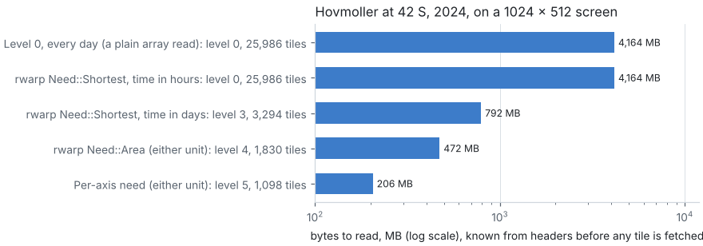

# m36: A visualizer as primitives, and a Hovmoller from the map planner

Status: musing, 2026-11-25. Tests one claim about visualizers against the
wxylib data model and runs its first case on real bytes. Based on
hypertidy/rwarp at `62e11dd` (`rwarp::view`, unchanged), the GHRSST MUR
2024 store (flat refs table from raad.virtualize, 366 daily COGs on
source.coop) and design at `a1851d0`. Builds on [doc 02](02-data-model.md)
(the rung ladder), [m05](m05-chunk-cache.md) (held chunks),
[m13](m13-four-views.md) (four views of one store),
[m29](m29-vrt-reimagined.md) (steps, placements, refs),
[m31](m31-view-chunk-planner.md) (the view-to-chunk planner),
[m32](m32-byterefs-position.md) (byterefs) and
[m35](m35-unstructured-and-dggs.md) (meshes and DGGS). Measurements:
[measurements/m36-hovmoller](../measurements/m36-hovmoller/README.md).

## Summary

The claim, from a visualizer model developed alongside a byte-reference
store that swaps encoded chunks in as a cache: a view is a primitive
(points, line, surface, volume), the array axes it spans, and a placement
into the scene, of which a CRS is one kind. Then `aes()` and `geom()` in
the grammar of graphics nominate how data on vertices or on primitives is
handled, so the grammar's *data* and *geom* rows are the same spectrum of
structures and geometries that wxylib models, for logical representation
and for drawing alike. The model needs only two things across the
boundary: from the model to a primitive, sample positions in array
coordinates, topology, one value per position and a colour model; from a
primitive to the model, the visible extent and the sample spacing along
each spanned axis. What the grammar lacks, the byte-reference side
supplies: a plan whose cost is known before any read, and a split between
derivations that are stored and those that stay cached views.

- **The claim holds, with one addition.** Each geom is a rung of doc 02
  plus a registration (values on vertices or on cells), each position
  aesthetic is a choice of spanned axes, stat is a derivation, coord is
  the placement, scale is the colour model and facet is a plan repeated
  over another axis (section 2). The addition is that coord has to talk
  back: for arrays too large to draw whole, the placement decides what is
  read, which the grammar never needed.
- **The planner passes the first test unchanged.** `rwarp::view::plan_view`
  plans a Hovmoller (longitude by time at 42 S) with no code change, by
  describing the source as a (lon, time) grid whose levels halve
  longitude and not time, and placing it with an identity transform
  (section 4).
- **It plans it badly, for one reason.** The planner turns the screen into
  one scalar need per tile, in source world units. With axes of different
  kinds that scalar trades one axis against the other: for a 2024
  Hovmoller on a 1024 by 512 screen it reads 472 MB at level 4 where
  level 5 at 206 MB serves every pixel; its other rule (`Need::Shortest`)
  reads 792 MB with time in days and 4.16 GB with time in hours, for the
  same picture. Sample spacing per spanned axis, in array cells per
  screen pixel, removes both faults; it is the primitive-to-model half of
  the contract, as stated (figure 2, table in section 4).
- **Cost before read is exact.** The level 0 sizes in the flat refs table
  equal the TIFF headers' for all 366 days; overview sizes come from the
  headers alone (366 range reads of 128 KB, 12 s). The per-axis plan was
  priced at 205,547,537 bytes and the fetch returned 205,547,537 bytes.
- **Stored versus cached is a cost question the plan can answer.** The
  Hovmoller uses 0.82 MB of values out of 206 MB read, a factor of 250.
  A time-major copy of a coarse level is a stored derivation many views
  reuse; the extracted rows at 42 S are a cached view of one plan
  (section 5).
- **Build little.** No grammar layer in wxylib. Two small changes in
  `rwarp::view` (per-axis need with per-axis level factors, a stride for
  axes with no levels) plus Hovmoller cases in its test JSON, and the
  contract written down as test cases (section 7).

*Figure 1. Top: one day of GHRSST MUR at overview level 5, a (lon, lat)
slice. Middle: a year at 42 S, a (lon, time) slice, from the same COGs
and the same level, 1,098 tiles. Bottom: the same rows less each
longitude's annual mean; the eddies of the Agulhas retroflection (15 to
50 E) and the Brazil-Malvinas confluence (60 to 40 W) show as slanted
streaks, which is what a Hovmoller is for.*

## 1. The question

Several browser explorations ask the same thing of a store: what is in
this view, and which chunks at which level are needed to draw it.
`zarr.html` in wxylib/web asks it for COG and Zarr pyramids through
`rwarp::view` (m31). A Zarr and Icechunk store page asks it for virtual
stores, and the byte-reference store with swapped-in chunks asks it for
its cache, which also needs multiscales, stored or generated. Those pages
were not read for this note; the question is the same one.

If a visualizer is a set of primitives over spanned axes with a
placement, the question has one answer for every view, map or not. The
test is whether a view that is not a map, with axes of different kinds,
goes through the map planner with only its axes and placement changed.

## 2. The grammar against the ladder

The layered grammar (ggplot2's form) builds a plot from data, aesthetic
mappings, a geom, a stat, a position adjustment, scales, a coord and
facets. Read against doc 02:

| Grammar | wxylib | Notes |
|---|---|---|
| data | an array at a rung (R0 to R5) or a table (R6) | The grammar takes a long table, one row per vertex. An array is never turned into rows; its topology is implicit in its shape, which `geom_raster` already assumes |
| aes, position (x, y, z) | the spanned axes: which array dims or coordinate arrays go to which scene axis | A map spans (lon, lat); a Hovmoller (lon, time); a profile section (distance, depth); a time series one axis |
| aes, value (fill, colour) | the variable, after unpacking (`scale_factor`, `add_offset`, fill) | Unpacking is encoding, not a scale |
| geom | the primitive plus a registration | point, line, surface, volume; values on vertices (`geom_point`, `geom_path`, a node-located UGRID variable) or on cells (`geom_tile`, `geom_raster`, `geom_polygon`, a face-located variable) |
| stat | a derivation: select, decimate, reduce, contour, anomaly | Stored or cached (section 5) |
| position adjustment | none needed | Dodge and stack are for categorical data |
| scale (colour) | the colour model: ramp, limits, nodata colour, transform | Limits can come from the store (valid range) or from the values read |
| coord | the placement into the scene | A CRS is one; a polar plot, a flipped axis, a time axis in days, a globe are others |
| facet | the plan repeated over another axis | Small multiples over time or depth; m31's open question 2 |

Rung by geom:

| Rung | Natural primitive | Registration |
|---|---|---|
| R1, R2 regular and rectilinear | surface of quads (`geom_raster`, `geom_tile`) | cells |
| R3 curvilinear | surface of quads with stored corners | cells, or vertices for a node-centred model |
| R4 implicit mesh, R5 explicit mesh | surface of faces | faces, nodes or edges (UGRID's `location`) |
| R6 features | points, lines, polygons | vertices (points, lines) or faces (polygons) |
| a 1D slice of any rung | line | vertices |
| a 3D block of R1 or R2 | volume | cells |

The claim holds: every geom is a rung plus a registration and every
position mapping is a choice of axes. Where it strains is in what the
grammar never had to do. Its data is small enough to hold, so stat runs
on all of it and coord is applied last. Here the coord has to run first:
the placement and the screen decide which part of the data, at which
level, is read at all. That reversal is the primitive-to-model half of
the contract.

## 3. The two-way contract

### 3.1 Model to primitive

- **Sample positions in array coordinates.** Fractional indices along
  each spanned axis: cell centres for cell registration, corners for a
  surface drawn through vertices. World positions are the placement's
  business, not the model's.
- **Topology.** One of: implicit (a shape, R1 to R3 and R4 by
  arithmetic), explicit (connectivity, R5), ordered (a line), none
  (points).
- **One value per position.** Unpacked, with a nodata mask.
- **A colour model.** Ramp, limits, nodata colour, transform.

### 3.2 Primitive to model

- **Visible extent along each spanned axis**, as an interval in array
  coordinates, which may wrap (longitude) or be open (a globe's horizon).
- **Sample spacing along each spanned axis**, in array cells per screen
  pixel.

Where the placement is affine (a lon/lat map of a lon/lat grid, a
Hovmoller) the spacing is one number per axis for the whole view. Where
it is not (a polar view of a lon/lat grid, a globe) it varies over the
screen, so the primitive answers per screen region, which is what
`rwarp::view`'s per-tile plan already does for two spatial axes.

Array coordinates matter here. The same spacing expressed in world
units mixes degrees with days, or with metres of depth, and section 4
shows what that costs. In cells per pixel the rule is unit-free: an axis
needs level k when its spacing is at least the level's factor along that
axis, and an axis with no levels needs a stride.

### 3.3 Where each piece already lives

| Piece | Exists in | State |
|---|---|---|
| Spanned axes and slicing | wxy-domain index space (m07), m29 steps | 2D slices only in the planner (`rwarp::view` docs: "Other axes: a plan is for one 2D slice") |
| Placement | rwarp `CrsTransform`, proj4rs, terrio-crs; zarr.html's views | Any callback; affine placements need no CRS at all |
| Visible extent and spacing per region | `rwarp::view` `TilePlan` (`need`, `level`) | One scalar need per tile, in source world units |
| Topology for meshes | m33, m35 | Not read or drawn yet |
| Colour model | zarr.html (page code) | Not a shared piece; no need for one yet |

## 4. The first test: a Hovmoller from the map planner

### 4.1 Set-up

GHRSST MUR `analysed_sst` 2024: (time, lat, lon) = (366, 17999, 36000),
512 by 512 tiles one day deep, five overviews per COG that halve lon and
lat. A map slice is a 2D source over (lon, lat) for one day. A Hovmoller
at 42 S is a 2D source over (lon, time): six levels whose longitude cell
is 0.01 times 2^k and whose time cell stays one day, chunks of 512 by 1.
Each planned key (level, lon chunk, day) becomes the tile (day, level,
tile row of 42 S at that level, lon chunk). Placement: identity, with
longitude wrapping every 360. Screen: 1024 by 512 for both. Both go
through `plan_view` unchanged
([plan/src/main.rs](../measurements/m36-hovmoller/plan/src/main.rs)).

### 4.2 Results

Map slice, whole world: level 5, 6 tiles. Hovmoller, all longitudes,
bytes from the harvested tile sizes (exact up to 366 days; the ten-year
rows scale the 2024 mean per day by the days read):

| Span | Rule | Level | Tiles | MB |
|---|---|---|---|---|
| 30 days | `Need::Area` | 1 | 1,080 | 245.3 |
| 30 days | `Need::Shortest` | 0 | 2,130 | 352.1 |
| 30 days | per-axis | 5 | 90 | 16.9 |
| 2024 (366 days) | level 0, every day (a plain array read) | 0 | 25,986 | 4,164.0 |
| 2024 | `Need::Shortest`, time in hours | 0 | 25,986 | 4,164.0 |
| 2024 | `Need::Shortest`, time in days | 3 | 3,294 | 791.8 |
| 2024 | `Need::Area` (days or hours) | 4 | 1,830 | 472.3 |
| 2024 | per-axis (days or hours) | 5 | 1,098 | 205.5 |
| 10 years (3,653 days) | `Need::Area` | 5 | 10,836 | about 2,030 |
| 10 years | `Need::Shortest`, time in days | 3 | 32,472 | about 7,800 |
| 10 years | per-axis, stride 7 days | 5 | 1,566 | about 293 |

*Figure 2. The 2024 Hovmoller priced by each rule from tile sizes alone,
before any tile was fetched.*

What this shows:

- **No change was needed to plan it.** The planner took a non-map 2D
  source and an identity placement and returned valid keys; the drawing
  in figure 1 is from those keys.
- **One scalar need couples the axes.** `Need::Area` takes the square
  root of the Jacobian determinant, so the longitude level is set by
  longitude spacing times time spacing. A short span (30 days on 512
  rows, 0.06 days per pixel) drags longitude four levels finer than the
  screen can show; a long one (ten years, 7 days per pixel) would drag it
  coarser, but level 5 is the last level so it is clamped there. Units
  cancel in this rule, which hides the fault.
- **`Need::Shortest` depends on the units.** It compares the smaller
  singular value with the level cell, both in world units, so the same
  picture costs 792 MB with time in days and 4.16 GB with time in hours.
- **Per-axis spacing fixes both.** Longitude spacing alone (0.35 degrees
  per pixel) picks level 5 at every span; time spacing picks a stride for
  the axis that has no levels (one day in seven for ten years on 512
  rows).
- **Axes with no levels need a stride, which the planner does not have.**
  For ten years, `Need::Area` reads every day (3,612 of them), seven times
  what 512 screen rows can show.
- **The per-tile box leaves gaps when cells are much smaller than
  pixels.** Footprints are built from pixel-centre samples padded by one
  cell, so at 7 days per pixel the ten-year plan skips 41 days at tile
  edges. Nearest drawing never samples those days; a renderer that
  averages would show the gap. On map views the chosen level keeps cells
  near pixel size and the pad covers it.
- **Cost before read is exact.** Predicted 205,547,537 bytes for the
  per-axis 2024 plan; fetched 205,547,537.

## 5. Stored derivations and cached views

The per-axis Hovmoller reads 1,098 tiles to use one row of each: 0.82 MB
of values from 206 MB. At level 5 those three tiles a day hold nearly all
of the level's bytes (the second tile row covers only the 51 southernmost
rows), so a year at one latitude costs as much as the whole of level 5
for the year.

Two derivations could change that, and they belong on different sides:

- **Stored: keyed by the source alone, reused by many views, made by a
  fixed rule.** Spatial overviews are one (they exist, inside each COG).
  A time-major copy of a coarse level is another: level 5 for 2024 is
  about 464 MB unpacked and 206 MB as stored now; rechunked to
  (366, 8, 1125) it would serve any latitude's year at level 5 from one
  chunk of about 6.6 MB unpacked (an estimate, not built). It pays when
  many Hovmollers, time series or animations are drawn from the store.
- **Cached: keyed by a plan, cheap to rebuild from stored bytes.** The
  366 by 1125 rows at 42 S are the derivation of one plan; they are
  worth holding while the view is in use and not worth publishing.

The byte-reference side makes the choice concrete. A cached view is a
small array whose refs point at held bytes (m05's held state), and a
stored derivation is a new array with its own refs and a declared
relation to its source (byterefs proposal 0006 carries overviews this
way: `overview_of`, `overview_factor`, `overview_resampling`). Either way
the planner can price a view against each candidate before reading, and
the decision to store is a comparison of those prices over expected use.
The cache that swaps encoded chunks in under the same keys is the same
mechanism seen from the store: the plan names keys, the store answers
from source bytes or held bytes, and the plan cannot tell which.

Two gaps in today's tables:

- The flat refs table carries level 0 only. Overview sizes had to come
  from the TIFF headers (366 reads of 128 KB, 12 s for the year). With
  overview levels as arrays in the table (0006), a planner prices any
  plan from the table alone.
- m32 recommended that 0006 exclude time reductions. That still holds
  for overviews; a time-major copy is a rechunk, not a reduction, and a
  monthly mean is a stored derivation with its own name rather than a
  level of the daily array.

## 6. Relation to existing work

- **m31 and `rwarp::view`.** The primitive-to-model half exists for two
  spatial axes with one scalar need. This note asks for the need per
  axis and for per-axis level factors, and adds a Hovmoller to the test
  cases. Nothing else in the module changes.
- **m29.** Its placements are source windows pasted into a destination
  array; the placement here is the array's placement into the scene.
  Different levels, same word: this note says "scene placement" where
  both could be meant. A Hovmoller is an m29 step (select one latitude)
  over the same refs, and a plan as a table could carry view plans as
  well as mosaic plans.
- **m13 and BRAN.** BRAN has no levels, so only the stride half applies,
  and its chunk shape sets the amplification; not measured here.
- **GDAL's xarray backend.** A reader with no notion of levels, such as an
  array read of `mdim.vrt` through osgeo.gdal and xarray, makes the
  level 0 read: 4.16 GB for this view. The per-axis plan is the level and
  stride such a reader would need to be told; that consumer is one more
  place the plan can be handed to.
- **m35.** Mesh views use the same contract with explicit topology; the
  spacing on a mesh is per face, not per axis, and is left for when a
  mesh is drawn.

## 7. What to do, and not

When a viewer needs it (zarr.html gaining a time axis, or a store page
asking for a Hovmoller):

1. `rwarp::view`: need per source axis in cells per pixel, levels with a
   factor per axis (`[2, 2]` for spatial pyramids, `[2, 1]` for a
   Hovmoller of one), and a stride for axes with no levels. Keep
   `Need::Area` as the default for two spatial axes, where it is right.
2. Add Hovmoller cases (30 days, a year, ten years) to
   `tests/fixtures/view/cases.json`, so other planners can run them.
3. Write the two-way contract into the planner's docs as the interface
   other viewers can hold it to.

Not now: a grammar-of-graphics layer in wxylib, a colour-model crate, a
viewer page for Hovmollers, a time-major copy of any store.

## 8. What we get, what it costs, what if we didn't

- **Get:** one planner for every 2D view a viewer can make of an N-D
  store, maps and not; a statement of the boundary that the planner,
  zarr.html and the store pages can all hold; a way to decide what to
  store and what to cache from prices known before reading.
- **Cost:** a per-axis need and a stride in `rwarp::view` (tens of
  lines) and three test cases; the measurement scripts here.
- **If we didn't:** non-map views get planned as maps with the wrong
  level, costing 2.3 times (`Need::Area`) to 20 times (`Need::Shortest`,
  hours) the bytes for a year, and more for longer spans; each viewer
  works out its own slicing and stride.

## 9. Open questions

1. Volumes and 3D placements: a volume spans three axes and the screen
   has two. Does the spacing per axis come from the screen projection of
   each axis (as for a tilted view), or from a depth budget?
2. Mixed placements: a Hovmoller whose longitude is reprojected (a
   distance along a ship track by time). The planner already takes a
   callback; whether a callback that bends one axis and not the other
   needs anything more is untested.
3. Stride and chunks along the strided axis: with one day per chunk a
   stride saves bytes in proportion; with a time chunk of 30 days it
   saves nothing. Should the planner snap strides to chunk boundaries or
   report the waste?
4. When should a store publish a time-major copy? A rule from expected
   views and prices is easy to write and hard to know the inputs of.
